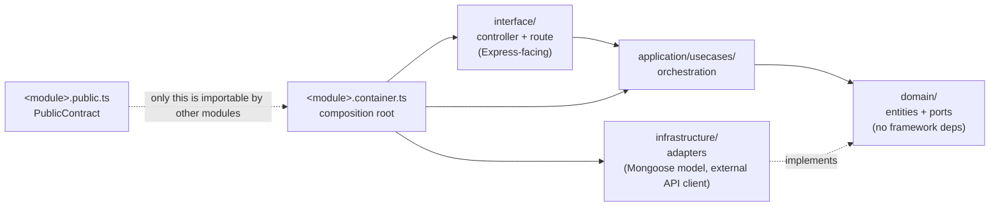

# Module Anatomy

Every business module in `apps/api/src/modules/` follows the same four-layer shape, established
by `modules/health/` — the reference implementation, nine files, five minutes to read.

## The layers, walked through `health`

**`domain/`** — entities and **ports**: interfaces for anything external the module needs (a
Mongoose repository, an external API client). No Express import, no Mongoose import. `health`'s
`domain/healthProbe.port.ts` declares `HealthProbePort`; `domain/health.entity.ts` declares the
`HealthReport` shape it returns. Nothing here knows how a probe is actually implemented.

**`application/usecases/`** — one class per use case, constructor-injected with only the ports
it needs, never a concrete adapter. `health`'s `GetHealthUseCase` takes `HealthProbePort[]` — it
could run against the real Mongo probe or a test double without changing a line.

**`infrastructure/`** — concrete adapters implementing those ports. `health`'s
`MemoryHealthProbe` is exactly the kind of adapter a Mongoose-backed repository will be once a
real module lands — just against a real collection instead of memory. **Mongoose models and
schemas live only here**, in whichever module owns that collection.

**`interface/`** — Express controller + router, translating HTTP ↔ use case calls. `health`'s
`health.controller.ts` and `health.route.ts` do nothing but that translation; look here first
when tracing what an endpoint actually does before it reaches a use case.

**`<module>.container.ts`** — the composition root. Builds the adapters, injects them into the
use cases, and returns `{ contract, buildRouter }`. `health.container.ts`'s
`buildHealthContainer()` is the whole pattern in ~15 lines: instantiate adapters → instantiate
use cases with those adapters → return the contract and a `buildRouter` closure.

**`<module>.public.ts`** — the `PublicContract` type. **This is the only thing another module is
allowed to import.** `health.public.ts` exports one method, `report()`. No module reaches into
another's `domain/` or `infrastructure/` directly; every cross-module call goes through a
contract shaped exactly like this one.

## How a request actually flows

1. `server.ts` calls `createApp()` (`app.ts`), which calls `buildContainers()` (`container.ts`).
2. `container.ts` calls each module's `build<Module>Container()` — today just `health`'s. Each
   returns `{ contract, buildRouter }`.
3. `routes.ts` mounts each module's `buildRouter()` under `/api/<module>` (`health` → `/api/health`).
4. A request hits the mounted route → the module's `interface/` controller → the use case in
   `application/` → a port method, fulfilled by whichever adapter the container wired in
   `infrastructure/`.
5. A use case returns a domain entity; the controller calls `sendSuccess`/`buildErrorBody`
   (`shared/http/response.util.ts`) to wrap it in the envelope every response shares
   (`HttpSuccessBody`/`HttpErrorBody` from `@greynote/contracts`).

## Composition roots expose `buildRouter()`, not a `router`

`HealthContainer.buildRouter` is a function, not an eagerly-built `Router` instance. This matters
the moment a second composition root exists (a worker process, a script) that needs a module's
`contract` but never serves HTTP — an eager `router` property would allocate an Express router,
its middleware and validation schemas in a process with no listener, for every module, forever.

## Building a new module

Copy `modules/health/`, rename the files, and work outward from `domain/` (what does it own,
what does it need from outside) to `interface/` (what does it expose over HTTP). The checklist
is [`adding-a-module.md`](adding-a-module.md); the tier it belongs in is already decided in
`.dependency-cruiser.cjs`'s `MODULE_TIERS` — see [`boundaries-and-enforcement.md`](boundaries-and-enforcement.md).
