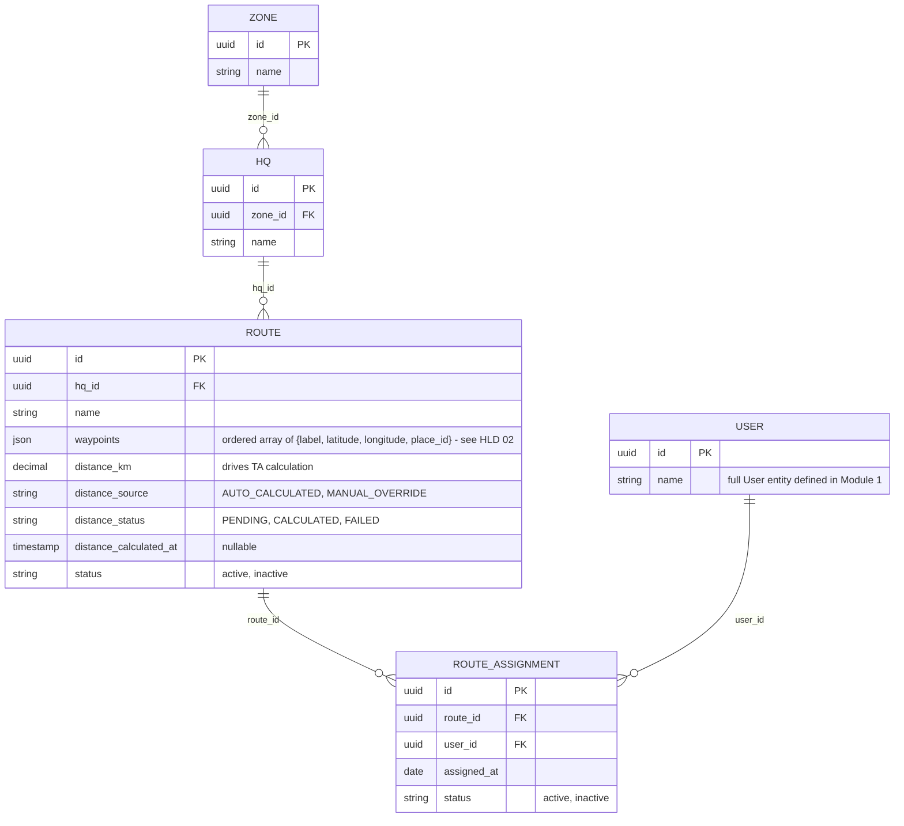

# Module 2: Territory Master

Covers: `Zone`, `HQ`, `Route`, and MR-to-route assignment (PRD §5.1).

## Diagram

## Design decisions locked for this module

- **Three-level hierarchy, no Area.** `Zone → HQ → Route`, matching the PRD exactly. No intermediate `Area` entity — it was considered and dropped since nothing in the PRD currently needs a grouping level below HQ.
- **Waypoints stay a single ordered `json` array on `Route`, not a separate table** — but each entry is now a resolved `{label, latitude, longitude, place_id}` object, not a bare label. Admin types each waypoint as text; the coordinates behind it come from a geocoding step at entry time (full flow in HLD 02). Still not normalized into its own table — no requirement yet to render the route on a map; revisit if that need shows up.
- **`distance_km` carries provenance and status, not just a number.** `distance_source` (`AUTO_CALCULATED`/`MANUAL_OVERRIDE`) records whether Admin's own edit is the current value; `distance_status` (`PENDING`/`CALCULATED`/`FAILED`) gates anything downstream that depends on a real distance — a `Route` can be saved before its distance resolves, but Expense/TA generation must not silently treat a `PENDING`/`FAILED` route as zero distance. Editing waypoints always re-triggers calculation and resets `distance_source` back to `AUTO_CALCULATED`, since a changed route makes any prior manual override stale. Full flow in HLD 02.
- **Many-to-many MR ↔ Route via `RouteAssignment`.** A route can have multiple MRs (shared coverage) and an MR can cover multiple routes. The join table also gives a lightweight assignment history (`assigned_at`, `status`) instead of silently overwriting a single FK on reassignment.
- **Doctor/Chemist attachment to routes is deferred.** PRD §5.1 says Admin "attaches Doctors/Chemists to those routes" — that join can't be modeled until those entities exist, so it's added in Module 3.

## Next

**Module 3 — Field Master Data.** Doctor, Chemist, Distributor, Product, Sample — plus the Doctor/Chemist ↔ Route attachment deferred from this module.
