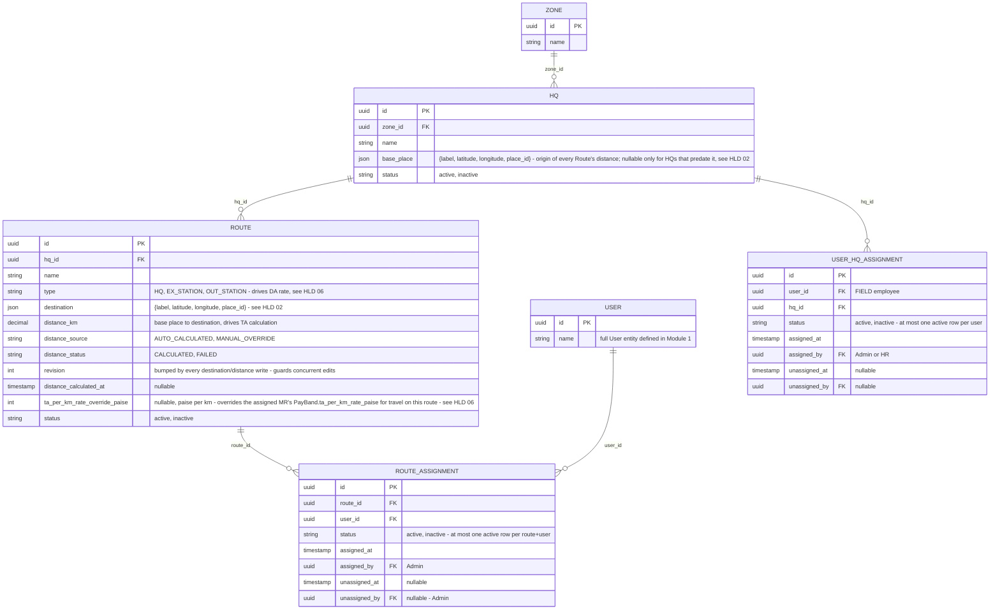

# Module 2: Territory Master

Covers: `Zone`, `HQ`, `Route`, and MR-to-route assignment (PRD §5.1; client Master spec
M1 "Organization Master"). `Area` was removed 2026-10-03 (`docs/decision-log.md`).

## Diagram

## Design decisions locked for this module

- **Three-level hierarchy: `Zone → HQ → Route`.** `Area` was added 2026-09-24 (client Master spec M1: "Route is inside Area") and removed 2026-10-03 (`docs/decision-log.md`): the client's real structure is a headquarters town with routes out to nearby places. Example: West Bengal Zone → SLG-1 HQ (base place Siliguri) → routes SLG-1 → Naxalbari and SLG-1 → Dhupguri. Zone is always reached transitively (`Route → HQ → Zone`); a Route stores only `hq_id`, no denormalized `zone_id`.
- **`HQ.base_place` is the origin of every Route's distance.** One resolved `{label, latitude, longitude, place_id}`, entered the same way a Route's destination is. It is required when an HQ is created; it is nullable in storage only because HQs that existed before it (and HQs created by CSV import, which can't carry a confirmed pin) have none until an Admin sets it. An HQ without one can't get a Route. Changing it recalculates the HQ's Routes except manual overrides.
- **`Route.type` (`HQ` / `EX_STATION` / `OUT_STATION`) is what drives DA.** Each grade carries a separate DA rate per type, so the Route a day's plan uses decides which DA rate applies. Full formula in HLD 06 §2. It moved here from `Area` on 2026-10-03; sign-off D5 ("Route vs Area type") is retired with it.
- **A Route is one `destination`, not a waypoint list.** A single resolved `{label, latitude, longitude, place_id}` object. The coordinates behind it come from a geocoding step at entry time (full flow in HLD 02). Trips with a stop in the middle are one Route per destination, or a manual distance override.
- **`distance_km` carries provenance and status, not just a number.** `distance_source` (`AUTO_CALCULATED`/`MANUAL_OVERRIDE`) records whether Admin's own edit is the current value; `distance_status` (`CALCULATED`/`FAILED`) gates anything downstream that depends on a real distance — a `Route` saves even when the Directions call fails, but Expense/TA generation must not silently treat a `FAILED` route as zero distance. (`PENDING` was dropped 2026-09-24: distance is calculated during the save, so nothing is ever pending.) Editing the destination always re-triggers calculation and resets `distance_source` back to `AUTO_CALCULATED`, since a changed route makes any prior manual override stale. An HQ base-place change recalculates only non-overridden Routes. Full flow in HLD 02.
- **Many-to-many MR ↔ Route via `RouteAssignment`.** A route can have multiple MRs (shared coverage) and an MR can cover multiple routes. The join table also gives a lightweight assignment history (`assigned_at`, `status`) instead of silently overwriting a single FK on reassignment. Creating a `RouteAssignment` should validate its `user_id` resolves to a `FIELD`-role user via Identity's `isFieldRole` contract method — the same FIELD-only-check pattern Identity itself already uses.
- **`ta_per_km_rate_override_paise` is a plain nullable field, not a provenance pair like `distance_km`'s.** `PayBand.ta_per_km_rate_paise` (Module 1) is the default; when set, this overrides it for travel on this specific route (e.g. a remote/difficult route negotiated at a higher rate) — added 2026-09-23, `docs/decision-log.md`. Unlike `distance_km`'s `MANUAL_OVERRIDE`, it does **not** reset on a destination edit — a negotiated rate is unrelated to the route's geography, so editing the destination has no bearing on it — and needs no `distance_source`/`distance_status`-style pair, since there's no "auto-calculated" rate to fall out of sync with; it's simply present (use it) or absent (fall back to the pay band). See `hld/06-ta-da-auto-calculation.md` §2 for how this resolves per route when a `DailyPlan` carries more than one.
- **Doctor/Chemist/Distributor attachment to routes is deferred.** PRD §5.1 says Admin "attaches Doctors/Chemists to those routes", and the client rules (§17.2) add Distributors to the same list. That join can't be modeled until those entities exist, so it's added in Module 3.

- **An employee's HQ is `UserHqAssignment`, owned here** (added 2026-09-28 for HR's HQ/Zone holidays). Territory can validate the user through Identity; Identity (a tier below) can't validate an HQ, so the FK the Identity ERD once pencilled onto `EmployeeProfile` lives here instead. One active row per user, history kept like `RouteAssignment`.

## Next

**Module 3 — Field Master Data.** Doctor, Chemist, Distributor, Product, Sample — plus the Doctor/Chemist/Distributor ↔ Route attachment deferred from this module.
