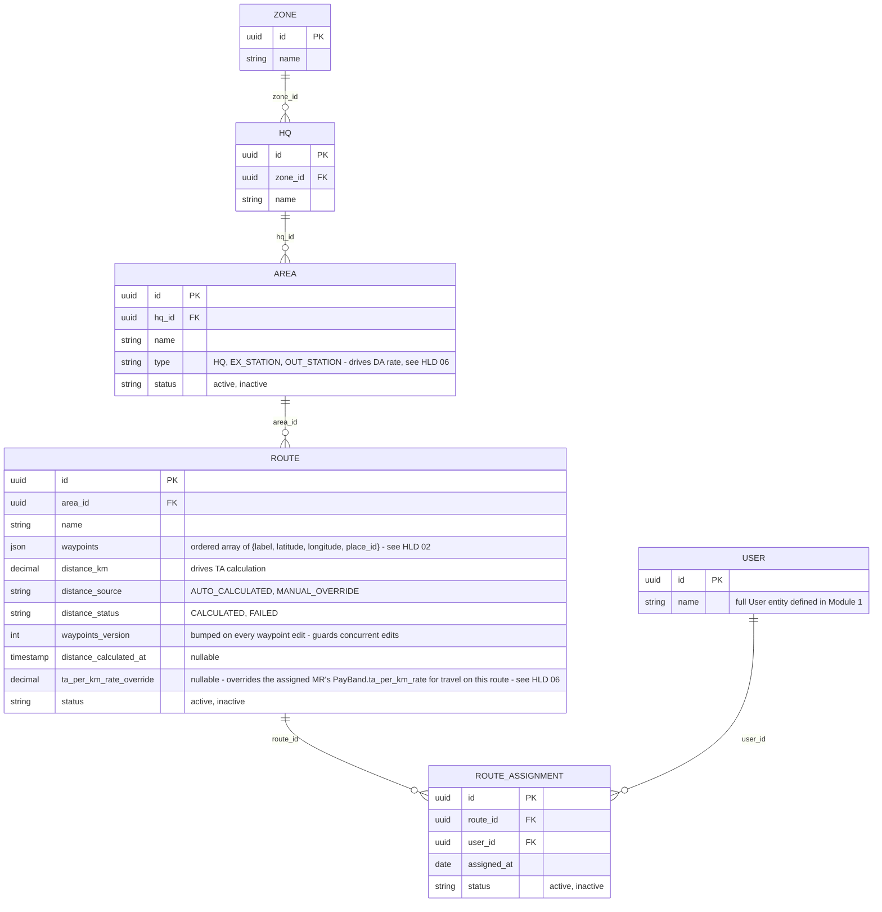

# Module 2: Territory Master

Covers: `Zone`, `HQ`, `Area`, `Route`, and MR-to-route assignment (PRD §5.1; client Master spec
M1 "Organization Master").

## Diagram

## Design decisions locked for this module

- **Four-level hierarchy: `Zone → HQ → Area → Route`.** Matches the client's Master spec (M1 Organization Master: "Route is inside Area"). An earlier version of this doc dropped `Area` as unneeded; reversed 2026-09-24 (`docs/decision-log.md`) once the client spec showed Area carries real business meaning. Example: West Bengal Zone → Siliguri HQ → Matigara Area → routes within Matigara. Zone/HQ are always reached transitively (`Route → Area → HQ → Zone`); no lower entity stores a denormalized `hq_id`/`zone_id`.
- **`Area.type` (`HQ` / `EX_STATION` / `OUT_STATION`) is what drives DA.** Each grade carries a separate DA rate per area type, so the Area a day's Route sits in decides which DA rate applies. Full formula in HLD 06 §2. The client spec also lists "Area Type" among Route's fields; this ERD keeps it on `Area` only and a Route always inherits its Area's type — confirmed by the client 2026-09-24 (sign-off D5).
- **Waypoints stay a single ordered `json` array on `Route`, not a separate table** — but each entry is now a resolved `{label, latitude, longitude, place_id}` object, not a bare label. Admin types each waypoint as text; the coordinates behind it come from a geocoding step at entry time (full flow in HLD 02). Still not normalized into its own table — no requirement yet to render the route on a map; revisit if that need shows up.
- **`distance_km` carries provenance and status, not just a number.** `distance_source` (`AUTO_CALCULATED`/`MANUAL_OVERRIDE`) records whether Admin's own edit is the current value; `distance_status` (`CALCULATED`/`FAILED`) gates anything downstream that depends on a real distance — a `Route` saves even when the Directions call fails, but Expense/TA generation must not silently treat a `FAILED` route as zero distance. (`PENDING` was dropped 2026-09-24: distance is calculated during the save, so nothing is ever pending.) Editing waypoints always re-triggers calculation and resets `distance_source` back to `AUTO_CALCULATED`, since a changed route makes any prior manual override stale. Full flow in HLD 02.
- **Many-to-many MR ↔ Route via `RouteAssignment`.** A route can have multiple MRs (shared coverage) and an MR can cover multiple routes. The join table also gives a lightweight assignment history (`assigned_at`, `status`) instead of silently overwriting a single FK on reassignment. Creating a `RouteAssignment` should validate its `user_id` resolves to a `FIELD`-role user via Identity's `isFieldRole` contract method — the same FIELD-only-check pattern Identity itself already uses.
- **`ta_per_km_rate_override` is a plain nullable field, not a provenance pair like `distance_km`'s.** `PayBand.ta_per_km_rate` (Module 1) is the default; when set, this overrides it for travel on this specific route (e.g. a remote/difficult route negotiated at a higher rate) — added 2026-09-23, `docs/decision-log.md`. Unlike `distance_km`'s `MANUAL_OVERRIDE`, it does **not** reset on a waypoint edit — a negotiated rate is unrelated to the route's geography, so editing waypoints has no bearing on it — and needs no `distance_source`/`distance_status`-style pair, since there's no "auto-calculated" rate to fall out of sync with; it's simply present (use it) or absent (fall back to the pay band). See `hld/06-ta-da-auto-calculation.md` §2 for how this resolves per route when a `DailyPlan` carries more than one.
- **Doctor/Chemist/Distributor attachment to routes is deferred.** PRD §5.1 says Admin "attaches Doctors/Chemists to those routes", and the client rules (§17.2) add Distributors to the same list. That join can't be modeled until those entities exist, so it's added in Module 3.

## Next

**Module 3 — Field Master Data.** Doctor, Chemist, Distributor, Product, Sample — plus the Doctor/Chemist/Distributor ↔ Route attachment deferred from this module.
