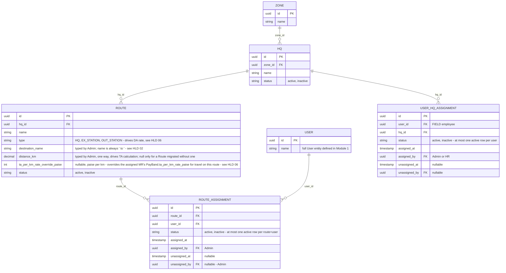

# Module 2: Territory Master

Covers: `Zone`, `HQ`, `Route`, and MR-to-route assignment (PRD §5.1; client Master spec
M1 "Organization Master"). `Area` was removed 2026-10-03 (`docs/decision-log.md`).

## Diagram

## Design decisions locked for this module

- **Three-level hierarchy: `Zone → HQ → Route`.** `Area` was added 2026-09-24 (client Master spec M1: "Route is inside Area") and removed 2026-10-03 (`docs/decision-log.md`): the client's real structure is a headquarters town with routes out to nearby places. Example: West Bengal Zone → SLG-1 HQ (base place Siliguri) → routes SLG-1 → Naxalbari and SLG-1 → Dhupguri. Zone is always reached transitively (`Route → HQ → Zone`); a Route stores only `hq_id`, no denormalized `zone_id`.
- **An HQ is a name under a Zone.** It had a `base_place` (a map-confirmed pin, the origin of the Google distance) until 2026-10-14; it was removed with the map. Renaming an HQ re-names its Routes.
- **`Route.type` (`HQ` / `EX_STATION` / `OUT_STATION`) is what drives DA.** Each grade carries a separate DA rate per type, so the Route a day's plan uses decides which DA rate applies. Full formula in HLD 06 §2. It moved here from `Area` on 2026-10-03; sign-off D5 ("Route vs Area type") is retired with it.
- **A Route is one `destination_name`, not a waypoint list.** A typed name; `name` is always `"<HQ> to <destination>"`, so it is unique per HQ exactly when the destination is. Trips with a stop in the middle are one Route per destination, or one Route with the total km.
- **`distance_km` is a number Admin types.** It carried `distance_source` / `distance_status` / `distance_calculated_at` / `revision` while Google calculated it (2026-09-24 to 2026-10-14); all four were removed when typing replaced the calculation (decision-log 2026-10-14). It is null only for a Route migrated from the map version whose lookup had failed; Expense/TA generation must not silently treat that as zero distance (the phone and TA still see it as `distanceStatus: FAILED`). Full flow in HLD 02.
- **Many-to-many MR ↔ Route via `RouteAssignment`.** A route can have multiple MRs (shared coverage) and an MR can cover multiple routes. The join table also gives a lightweight assignment history (`assigned_at`, `status`) instead of silently overwriting a single FK on reassignment. Creating a `RouteAssignment` should validate its `user_id` resolves to a `FIELD`-role user via Identity's `isFieldRole` contract method — the same FIELD-only-check pattern Identity itself already uses.
- **`ta_per_km_rate_override_paise` is a plain nullable field.** `PayBand.ta_per_km_rate_paise` (Module 1) is the default; when set, this overrides it for travel on this specific route (e.g. a remote/difficult route negotiated at a higher rate) — added 2026-09-23, `docs/decision-log.md`. It is unaffected by a destination or km edit — a negotiated rate is unrelated to the route's geography; it's simply present (use it) or absent (fall back to the pay band). See `hld/06-ta-da-auto-calculation.md` §2 for how this resolves per route when a `DailyPlan` carries more than one.
- **Doctor/Chemist/Distributor attachment to routes is deferred.** PRD §5.1 says Admin "attaches Doctors/Chemists to those routes", and the client rules (§17.2) add Distributors to the same list. That join can't be modeled until those entities exist, so it's added in Module 3.

- **An employee's HQ is `UserHqAssignment`, owned here** (added 2026-09-28 for HR's HQ/Zone holidays). Territory can validate the user through Identity; Identity (a tier below) can't validate an HQ, so the FK the Identity ERD once pencilled onto `EmployeeProfile` lives here instead. One active row per user, history kept like `RouteAssignment`.

## Next

**Module 3 — Field Master Data.** Doctor, Chemist, Distributor, Product, Sample — plus the Doctor/Chemist/Distributor ↔ Route attachment deferred from this module.

## 2026-10-15 — manager coverage

New `ManagerCoverage` collection: `user_id` (unique), `hq_ids[]`, `zone_ids[]`, `updated_at`, `updated_by`. Only for ASM and above; absent = none set.
