# Module 4: Field Activity — Calls, Followups & Expenses

Covers: the daily `DCR` envelope, `DoctorCall` (+ sample-given), `DoctorFollowup`, `ChemistCall`, `ChemistFollowup`, `Expense`, the Admin-issued `DoctorGift` allocation, and the approval-routed `DoctorService` request (PRD §6.2 A/B, §7.2–7.3).

## Diagram

```mermaid
erDiagram
    USER {
        uuid id PK
        string name "full User entity defined in Module 1"
    }
    DOCTOR {
        uuid id PK
        string name "full Doctor entity defined in Module 3"
    }
    CHEMIST {
        uuid id PK
        string name "full Chemist entity defined in Module 3"
    }
    ROUTE {
        uuid id PK
        string name "full Route entity defined in Module 2"
    }
    DOCTOR_SAMPLE_ALLOCATION {
        uuid id PK
        int quantity_remaining "full entity defined in Module 3"
    }

    DCR {
        uuid id PK
        uuid user_id FK
        date report_date
        string status "DRAFT, SUBMITTED, MANAGER_APPROVED, REJECTED"
        timestamp submitted_at
        uuid reviewed_by FK "nearest higher manager, nullable until reviewed"
        timestamp reviewed_at
    }
    DOCTOR_CALL {
        uuid id PK
        uuid dcr_id FK
        uuid doctor_id FK
        string working_type "FIELD_WORK, MEETING, CONFERENCE, STRIKE"
        json work_with "array of accompanying user_ids"
        string remarks
        decimal captured_latitude "MR's GPS at call time"
        decimal captured_longitude
        decimal accuracy_meters "the phone's reported GPS accuracy"
        string geofence_status "PASS, FAIL, UNVERIFIED, OVERRIDE"
        int geofence_distance_meters "nullable - the server's computed distance, kept when overridden"
        uuid geofence_overridden_by FK "nullable - the manager who accepted a FAIL/UNVERIFIED"
        timestamp geofence_overridden_at "nullable"
        string geofence_override_comment "nullable - required when overridden"
        timestamp created_at
    }
    DOCTOR_SAMPLE_GIVEN {
        uuid id PK
        uuid doctor_call_id FK
        uuid allocation_id FK "consumes DoctorSampleAllocation.quantity_remaining"
        int quantity_given
    }
    DOCTOR_FOLLOWUP {
        uuid id PK
        uuid dcr_id FK
        uuid doctor_id FK
        string remarks
        timestamp created_at
    }
    CHEMIST_CALL {
        uuid id PK
        uuid dcr_id FK
        uuid chemist_id FK
        string working_type "FIELD_WORK, MEETING, CONFERENCE, STRIKE"
        json work_with "array of accompanying user_ids"
        string remarks
        decimal captured_latitude "MR's GPS at call time"
        decimal captured_longitude
        decimal accuracy_meters "the phone's reported GPS accuracy"
        string geofence_status "PASS, FAIL, UNVERIFIED, OVERRIDE"
        timestamp created_at
    }
    CHEMIST_FOLLOWUP {
        uuid id PK
        uuid dcr_id FK
        uuid chemist_id FK
        string remarks
        timestamp created_at
    }
    EXPENSE {
        uuid id PK
        uuid dcr_id FK
        uuid route_id FK "nullable - the route distance behind an auto TA calc"
        string type "TA, DA, TRAVEL, MEAL, MISC"
        string source "AUTO (system-calculated TA/DA), MANUAL (logged by MR)"
        int amount_paise
        string remarks
        string payment_status "UNPAID, PAID, CANCELLED - separate from the DCR approval status; CANCELLED only for an unpaid AUTO row whose DCR Admin later rejected"
        bool accepted "the DCR stands past the manager (set/cleared by the approval hook) - the only rows the Accountant audits and may pay; a PAID row keeps it"
        bool distance_flag "AUTO TA only - a route's distance could not be calculated, so this TA is artificially low"
        uuid paid_by FK "nullable - Accountant who marked it paid"
        timestamp paid_at "nullable"
        timestamp created_at
    }
    DOCTOR_SERVICE {
        uuid id PK
        uuid doctor_id FK
        uuid user_id FK "the MR tied to this service - submitter, or auto-selected via DoctorAssignment when Admin-created"
        uuid created_by FK "who created the row - the MR themself, or an Admin"
        string service_type "TOUR_PACKAGE, GIFT, ONLINE_PROMOTION, OTHERS"
        int amount_paise
        string remarks
        string status "SUBMITTED, MANAGER_APPROVED, REJECTED"
        timestamp submitted_at
        uuid reviewed_by FK "nearest higher manager - stays null when Admin-created (auto-approved)"
        timestamp reviewed_at
    }
    DOCTOR_GIFT {
        uuid id PK
        uuid doctor_id FK
        uuid allocated_by FK "Admin user who set it"
        string product_name "free text"
        int amount_paise
        string status "PENDING, DONE"
        uuid completed_by FK "nullable - MR who marked it done"
        timestamp completed_at "nullable"
        timestamp allocated_at
    }

    USER ||--o{ DCR : "user_id"
    USER ||--o{ DCR : "reviewed_by (manager)"
    DCR ||--o{ DOCTOR_CALL : "dcr_id"
    DCR ||--o{ DOCTOR_FOLLOWUP : "dcr_id"
    DCR ||--o{ CHEMIST_CALL : "dcr_id"
    DCR ||--o{ CHEMIST_FOLLOWUP : "dcr_id"
    DCR ||--o{ EXPENSE : "dcr_id"
    DOCTOR ||--o{ DOCTOR_CALL : "doctor_id"
    DOCTOR ||--o{ DOCTOR_FOLLOWUP : "doctor_id"
    CHEMIST ||--o{ CHEMIST_CALL : "chemist_id"
    CHEMIST ||--o{ CHEMIST_FOLLOWUP : "chemist_id"
    DOCTOR_CALL ||--o{ DOCTOR_SAMPLE_GIVEN : "doctor_call_id"
    DOCTOR_SAMPLE_ALLOCATION ||--o{ DOCTOR_SAMPLE_GIVEN : "allocation_id"
    ROUTE ||--o{ EXPENSE : "route_id (TA distance calc)"
    USER ||--o{ EXPENSE : "paid_by (Accountant)"
    DOCTOR ||--o{ DOCTOR_SERVICE : "doctor_id"
    USER ||--o{ DOCTOR_SERVICE : "user_id"
    USER ||--o{ DOCTOR_SERVICE : "created_by"
    USER ||--o{ DOCTOR_SERVICE : "reviewed_by (manager)"
    DOCTOR ||--o{ DOCTOR_GIFT : "doctor_id"
    USER ||--o{ DOCTOR_GIFT : "allocated_by (Admin)"
    USER ||--o{ DOCTOR_GIFT : "completed_by (MR)"
```

## Design decisions locked for this module

- **Expense is included here**, not deferred — the PRD's Final Submission flow (§6.2 A) bundles it with Doctor/Chemist Calls and Followups into one daily approval, so it needs the same envelope from day one rather than retrofitting it later.
- **`DCR` is a single daily envelope, one row per user per date.** `DoctorCall`, `DoctorFollowup`, `ChemistCall`, `ChemistFollowup`, and `Expense` all attach to it via `dcr_id`. Its `status`/`reviewed_by` fields are exactly the two-stage approval from PRD §7.1: `reviewed_by` is always the nearest higher manager; once `status = MANAGER_APPROVED` the record is visible to Admin — no separate "forwarded to admin" field needed, since that visibility is derived from the same `manager_id` hierarchy walk established in Module 1, not stored state.
- **Chemist Call has no link to Order.** Order is fully standalone (Module 6), captured independently via the Marketing tab — confirmed explicitly, overriding the recommended default.
  - Carried forward to Module 6: Order (and Monthly Opening/Closing stock) must support attaching to **either** a Distributor **or** a Chemist, not just Distributor.
- **Sample-given is its own transaction, not a field on Doctor Call.** `DoctorSampleGiven` is one row per product+quantity given during a call (a call can give multiple samples), each referencing the `DoctorSampleAllocation` (Module 3) it draws down. The actual decrement of `quantity_remaining` is application logic (LLD), not a schema concern.
- **`working_type` on both Doctor Call and Chemist Call**, using the same dropdown as the Daily Plan (`FIELD_WORK`, `MEETING`, `CONFERENCE`, `STRIKE` — PRD §6.2 A). Kept as a plain string field here rather than its own lookup entity, matching the low-cardinality, rarely-changing nature of `Role`/`Designation`-style enums already used elsewhere.
- **`Expense` has a `payment_status` separate from `DCR`'s approval status.** `DCR.status = MANAGER_APPROVED` only means the _expense claim_ was approved — it doesn't mean the money moved. `payment_status` (`UNPAID`/`PAID`) plus `paid_by`/`paid_at` is the Accountant's own settlement step (PRD §5.3: "audits manager-approved TA/DA, marks as paid"), and is what Module 9's `PayrollRun` sums up per user per month — only `PAID` expenses count toward payroll, not merely-approved ones.
- **Geofence check on both Doctor Call and Chemist Call.** Each stores the MR's captured GPS (`captured_latitude`/`captured_longitude`) and a `geofence_status` result, validated against the registered `latitude`/`longitude` on Doctor/Chemist (Module 3) using the radius rule (`GEO_FENCE_RADIUS_METERS`) that will live in `SystemConfig` (Module 5).
- **Doctor Gift is now an Admin-issued allocation, same pattern as `DoctorSampleAllocation` (Module 3) — not an MR-logged entry.** Admin sets a gift (`product_name` as free text, plus `amount`) against a `Doctor`; the MR assigned to that doctor (via `DoctorAssignment`, Module 3) sees it and marks it `DONE` (`completed_by`/`completed_at`). Still no manager-approval step — it's Admin-authorized by construction, same as Sample.
- **Creating any DCR child requires today's `DailyPlan` to already be `MANAGER_APPROVED` (Module 5, HLD 10).** `DoctorCall`, `ChemistCall`, `DoctorFollowup`, `ChemistFollowup`, and `Expense` are all gated on the user's `DailyPlan` for that same `report_date`/`plan_date` — checked client-side against the locally-synced `DailyPlan` status before the screen is even usable, and re-validated server-side at sync, the same re-check pattern HLD 1 §1.4 already uses for `DoctorAssignment` drift. `DCR` Final Submission carries the same connectivity carve-out as `DailyPlan`/`MonthlyPlan` Submit (Module 5) — it requires a live connection at tap time rather than queuing offline, since it's also what the missed-DCR compliance block (HLD 10) keys off of.
- **A Doctor/Chemist Call's route must be in the day's approved Plan** (`ROUTE_NOT_IN_PLAN`), and a DCR's request is created already `APPROVED` (authority `AUTO`) when `DCR_APPROVAL_REQUIRED` is off — decision-log 2026-10-03.
- **Superseded 2026-09-24:** the `status`/`reviewed_by`/`reviewed_at` approval fields on `DCR` and `DoctorService` move to the `approval` module's `ApprovalRequest` (`../LLD/approval.md`); dropped when Field Activity is built.
- **Doctor Service is the one that gets the approval workflow**, not Gift. An MR can request/submit a Service themselves (`service_type`: `TOUR_PACKAGE`, `GIFT`, `ONLINE_PROMOTION`, `OTHERS`, plus `amount`) — this goes through the same nearest-manager-then-Admin approval as `DCR` and the Tour Plans (`status`/`reviewed_by`/`reviewed_at`). Note `GIFT` appears here too, as a _service_type_ option (e.g. a sponsored, bigger-ticket gift needing approval) — distinct from the standalone `DoctorGift` allocation above, which is for smaller Admin-issued items with no approval needed.
- **Admin can also create a Service directly for a doctor — auto-approved, no manager review.** `created_by` records who actually made the row. When Admin creates it, `status` is set straight to `MANAGER_APPROVED` and `reviewed_by`/`reviewed_at` stay null, since Admin is already the top of the approval chain. The `user_id` (the MR the service is tied to) is auto-selected from that doctor's single active `DoctorAssignment` (Module 3) at creation time and stored as a plain snapshot FK. If the doctor has no active assignment, Admin picks the MR explicitly rather than the system guessing.

## Next

**Module 5 — Planning (Daily/Monthly Plan) + Rules.** Tour Plan submission/approval (same two-stage pattern as this module's `DCR`), and the `SystemConfig` rule table referenced above (submission cutoffs, `GEO_FENCE_RADIUS_METERS`, device limits).
