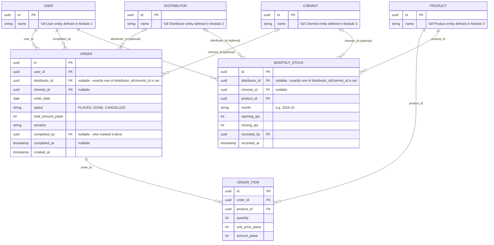

# Module 6: Sales & Orders

Covers: `Order` (+ `OrderItem`) and `MonthlyStock` — Chemist/Distributor monthly opening/closing counts (PRD §6.2 B, glossary "PRIMARY"/"SECONDARY" sales).

## Diagram

## Design decisions locked for this module

- **Built as one document:** in MongoDB an `Order` carries its `OrderItem` lines embedded, not as a second collection (2026-09-30) — one write, and the total is checked against the lines by the schema. The tables above describe the fields, not separate collections.

- **`Order` attaches to either `Distributor` or `Chemist` via two nullable FKs, exactly one populated** (an app-level/DB check constraint — `CHECK (distributor_id IS NOT NULL) != (chemist_id IS NOT NULL)`), rather than a shared "Outlet" supertype. Consistent with Module 3's decision to keep `Chemist` and `Distributor` as separate entities. No link back to `ChemistCall` (Module 4) — Order is fully standalone, as already decided.
- **`Order` is line-itemized via `OrderItem`.** One order can carry multiple products/quantities; `total_amount` on `Order` is a denormalized sum of its items for quick display, kept in sync by application logic.
- **`Order` carries a completion lifecycle, same shape as `DoctorGift`.** `status` moves `PLACED → DONE` (or `CANCELLED`), with `completed_by`/`completed_at` recording who marked it fulfilled and when — same pattern as Module 4's Gift allocation, since "no manager approval" and "no completion tracking" aren't the same thing.
- **PRIMARY vs SECONDARY sales (PRD glossary) aren't a field anywhere — they're derived, not stored.** `Order` always represents a primary sale (an actual order placed with a distributor/chemist). Secondary sales aren't logged directly; they're computed from `MonthlyStock`'s opening/closing counts (roughly: `opening_qty + primary sales received during the month - closing_qty`) — that computation is reporting/application logic, not a schema concern.
- **`MonthlyStock` is one row per outlet + product + month**, with the same polymorphic Distributor/Chemist attachment as `Order`. `recorded_by` tracks which MR submitted the count.
- **No approval workflow for `Order` or `MonthlyStock`.** PRD §7 only routes Tour Plans, DCR & Expenses, and (from Module 4) MR-submitted Doctor Service through manager approval — orders and stock counts are captured directly, same treatment as `DoctorGift`.

## Next

**Module 7 — HR Ops.** `Leave` and `Holiday` — including `Holiday.hq_id`, tying the holiday calendar to the HQ hierarchy from Module 2.
