# Module 7: HR Ops

Covers: `LeaveType`, `LeavePolicy` (grade-wise Leave Master), `LeaveBalance`, `Leave`, and `Holiday` (+ `HolidayZone`/`HolidayHQ`) (PRD §5.3, §6.2 D).

## Diagram

```mermaid
erDiagram
    USER {
        uuid id PK
        string name "full User entity defined in Module 1"
    }
    PAY_BAND {
        uuid id PK
        string name "full PayBand entity defined in Module 1"
    }
    ZONE {
        uuid id PK
        string name "full Zone entity defined in Module 2"
    }
    HQ {
        uuid id PK
        string name "full HQ entity defined in Module 2"
    }

    LEAVE_TYPE {
        uuid id PK
        string name "CASUAL, SICK, EARNED, LOSS_OF_PAY, ..."
        boolean is_paid
    }
    LEAVE_POLICY {
        uuid id PK
        uuid pay_band_id FK
        uuid leave_type_id FK
        decimal default_allocated_days "per leave year - the grade-wise Leave Master; paid types only"
        uuid updated_by FK "HR user"
        timestamp updated_at
    }
    LEAVE_BALANCE {
        uuid id PK
        uuid user_id FK
        uuid leave_type_id FK
        int year "leave year (financial year, by its start year)"
        decimal allocated_days "seeded lazily from LeavePolicy, pro-rata for a mid-year joiner; HR-editable"
        decimal used_days
        decimal pending_days "requested, not yet decided"

        uuid updated_by FK "HR user, nullable - set when HR manually adjusts"
        timestamp updated_at
    }
    LEAVE {
        uuid id PK
        uuid user_id FK
        uuid leave_type_id FK
        date start_date
        date end_date
        string half "nullable - FIRST, SECOND; only when start_date = end_date"
        json days "the counted days: [{date, portion}] - off days and holidays excluded"
        decimal days_count "sum of days.portion"
        string reason
        string status "PENDING, APPROVED, REJECTED"
        uuid reviewed_by FK "HR user, not the manager chain"
        timestamp reviewed_at
        timestamp created_at
    }
    HOLIDAY {
        uuid id PK
        string name
        date holiday_date
        string scope "NATIONAL, ZONE, HQ"
        json zone_ids "ZONE scope - embedded, replacing HOLIDAY_ZONE"
        json hq_ids "HQ scope - embedded, replacing HOLIDAY_HQ"
        uuid created_by FK "HR user"
        timestamp created_at
    }
    HOLIDAY_ZONE {
        uuid id PK
        uuid holiday_id FK
        uuid zone_id FK
    }
    HOLIDAY_HQ {
        uuid id PK
        uuid holiday_id FK
        uuid hq_id FK
    }

    PAY_BAND ||--o{ LEAVE_POLICY : "pay_band_id"
    LEAVE_TYPE ||--o{ LEAVE_POLICY : "leave_type_id"
    USER ||--o{ LEAVE_POLICY : "updated_by (HR)"
    USER ||--o{ LEAVE_BALANCE : "user_id"
    LEAVE_TYPE ||--o{ LEAVE_BALANCE : "leave_type_id"
    USER ||--o{ LEAVE_BALANCE : "updated_by (HR)"
    USER ||--o{ LEAVE : "user_id"
    LEAVE_TYPE ||--o{ LEAVE : "leave_type_id"
    USER ||--o{ LEAVE : "reviewed_by (HR)"
    USER ||--o{ HOLIDAY : "created_by (HR)"
    HOLIDAY ||--o{ HOLIDAY_ZONE : "holiday_id"
    ZONE ||--o{ HOLIDAY_ZONE : "zone_id"
    HOLIDAY ||--o{ HOLIDAY_HQ : "holiday_id"
    HQ ||--o{ HOLIDAY_HQ : "hq_id"
```

## Design decisions locked for this module

- **Leave allocation is grade-wise, not per-individual by default.** `LeavePolicy` is the "Leave Master" HR manages: a default `default_allocated_days` per `(PayBand, LeaveType)` combination — pick a grade, get its default leave days per type.
- **`LeaveBalance` is the live, per-user ledger — seeded from `LeavePolicy`, but independently HR-editable.** When a user's pay band is set, their balance for each leave type initializes from that grade's `LeavePolicy` row; HR can then adjust an individual's `allocated_days` directly (e.g. a one-off compensation) without changing the grade-wide policy.
- **`LeaveType` carries `is_paid`.** This is what feeds the Accountant's payroll deduction sync (PRD §5.3: "Syncs approved unpaid leaves for deduction") — an unpaid leave type (e.g. Loss of Pay) is what gets flagged for deduction, not a property of the individual `Leave` request.
- **Superseded 2026-09-24:** Leave goes Employee → Manager → HR or Admin through the `approval` module (client §11.2; `../decision-log.md`); `Leave.reviewed_by` is dropped when HR is built. The bullet below is the earlier design.
- **Leave requests are approved by HR directly — the one workflow that bypasses Module 1's nearest-manager chain.** PRD §5.3 explicitly assigns "approve/reject leaves" to HR, not to the reporting hierarchy, so `Leave.reviewed_by` is an HR user, not `manager_id`-derived.
- **Holiday scope supports National, Zone, or HQ — and a holiday can be tagged to multiple zones or multiple HQs at once.** `scope = NATIONAL` applies everywhere implicitly (no join rows needed). `scope = ZONE` or `HQ` uses `HolidayZone`/`HolidayHQ` join tables rather than a single FK, since one regional festival can span several zones or HQs simultaneously.
- **Weekly off (e.g. Sunday) is not modeled as 52 `Holiday` rows a year.** It's a recurring rule, not a dated event, so it lives in `SystemConfig` (Module 5) as e.g. `WEEKLY_OFF_DAY = SUNDAY` — application logic treats it as a non-working day alongside whatever `Holiday` rows apply, without enumerating it as data.

- **Built 2026-09-28 (Phase 4) — what changed from the diagram above:** `Leave.status`/`reviewed_by`/`reviewed_at` are dropped (the `LEAVE` `ApprovalRequest` holds them); `HOLIDAY_ZONE`/`HOLIDAY_HQ` become embedded `zone_ids`/`hq_ids` arrays on `Holiday`; days are decimal (half days); `LeaveBalance` gains `pending_days` and is seeded lazily per leave year. An employee's HQ/Zone comes from Territory's `UserHqAssignment`. Rules: `../LLD/hr.md`.

## Next

**Module 8 — Marketing (Visuals).** The last module: e-detailing visuals and campaigns (PRD §6.2 B), plus wrapping up the full ERD set.
