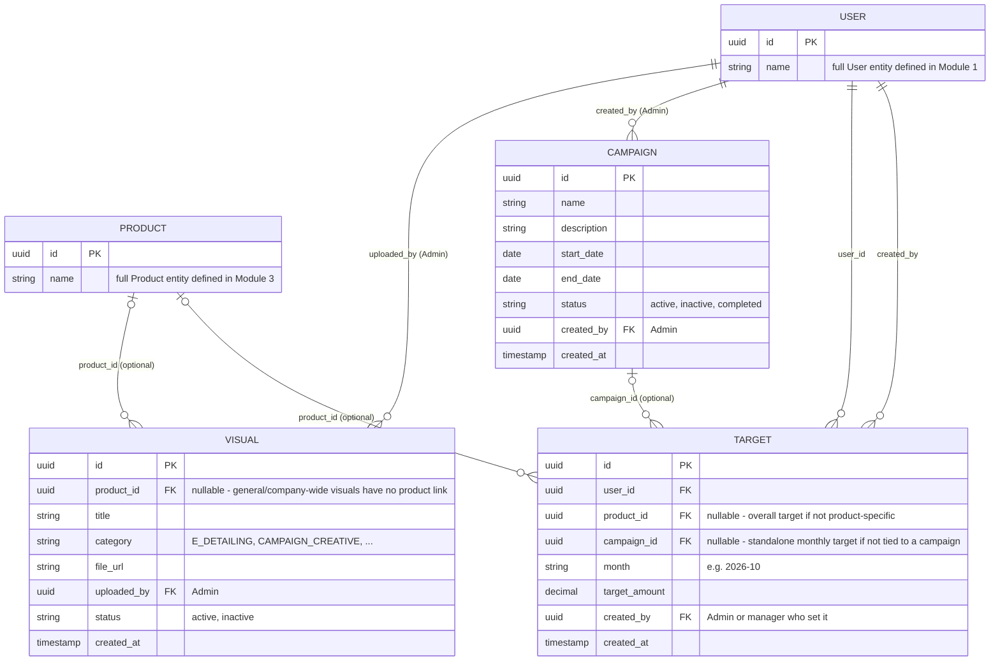

# Module 8: Marketing (Visuals & Campaigns)

Covers: `Visual`, `Campaign`, and `Target` (PRD §6.2 B).

## Diagram

## Design decisions locked for this module

- **`Visual.product_id` is a nullable FK to `Product`.** Most e-detailing content is drug-specific, so linking it lets MRs filter by product — but it stays nullable to allow general/branding visuals with no single product behind them.
- **`Campaign` is company-wide, no Zone/HQ scoping.** Every active campaign is visible to every field worker — no `CampaignZone`/`CampaignHQ` join table, unlike `Holiday` in Module 7. Simplest fit for what the PRD actually describes; can be revisited if regional campaign targeting becomes a real requirement.
- **`Target` is per User per month, optionally narrowed by Product and/or Campaign** (both nullable FKs) — one shape covers a general monthly sales target, a product-specific target, and a campaign-tied target, without needing three separate entities.
- **"Achieved" isn't a stored field on `Target`.** It's derived by aggregating that user's `OrderItem` rows (Module 6) for the matching month/product — same "derived, not stored" treatment used for secondary sales in Module 6, kept as reporting logic rather than a column that can drift out of sync with the source data.
- **A manager's effective target is their own `Target` row (if any) *plus* a computed rollup of their downline's `Target` rows.** Any user — MR or manager — can have their own directly-assigned `Target` row (e.g. Admin sets a personal stretch goal on an RSM). Separately, whenever a manager's target is reported, the system also recursively sums every `Target` row belonging to users under them in the `manager_id` hierarchy (Module 1) for the same month/product. The rollup is computed at read time, not stored — no schema change needed, since `Target.user_id` already accepts any `User` regardless of role/designation; the only requirement is that reporting logic walks the hierarchy rather than only reading a manager's own row.

## Cross-cutting note

Target reporting depends on two things this ERD set already models: `User.manager_id` (Module 1, for the downline walk) and `OrderItem` (Module 6, for achieved figures). No new entity is needed to support the rollup — it's a query pattern, not a table.

## Status

This is the last of the 8 planned modules — the ERD set is now complete. See `README.md` for the full index. Next: HLD.
