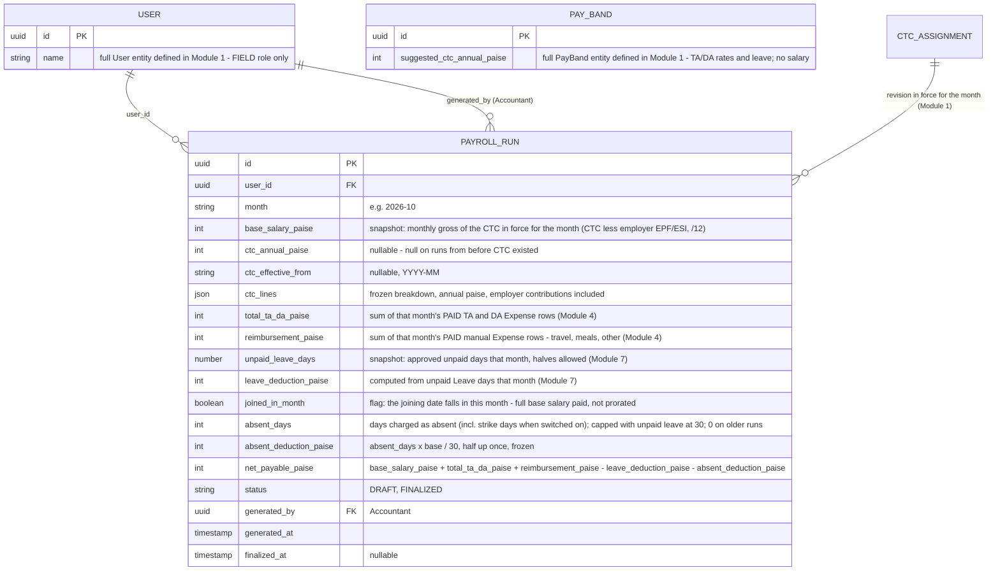

# Module 9: Payroll & Compensation

Covers: `PayrollRun` — the final processed salary sheet (PRD §5.3, glossary "PAYROLL"). Added after auditing the ERD set against PRD §5.3 and finding no entity behind the Accountant's "generates final PAYROLL sheet" responsibility.

## Diagram

## Design decisions locked for this module

- **Payroll is FIELD-role only**, consistent with Module 1's decision that `PayBand` no longer carries a salary; the CTC (`CtcAssignment`) only applies to FIELD-role users. Admin/HR/Accountant compensation is assumed handled by a separate, external company payroll system outside this SFA tool.
- **`PayrollRun` is a stored, finalized record — not a live-computed report.** Same treatment as `DCR`/Tour Plans: once Accountant generates and finalizes a run, its numbers are locked in, even if a later edit touches the underlying `Expense` or `Leave` data for that month. This matches "generates final PAYROLL sheet" as a deliberate, one-time action per PRD's glossary — not an always-live dashboard figure (unlike `Target`'s achieved/rollup figures, which stay derived).
- **`base_salary` is snapshotted at generation time**, not re-read from the CTC later — if the employee's CTC is revised next quarter, past `PayrollRun` rows for prior months must stay accurate to what was actually paid.
- **`total_ta_da` only sums `Expense` rows with `payment_status = PAID`** (Module 4) — an approved-but-unpaid expense claim doesn't count toward payroll yet. This is what actually connects the Accountant's two responsibilities from PRD §5.3: "marks as paid" (Module 4) happens first, "generates final PAYROLL sheet" (this module) reads the result.
- **`leave_deduction` is computed, not itself a stored breakdown.** It's derived from that month's unpaid `Leave` days (Module 7, `LeaveType.is_paid = false`) at generation time, then baked into the snapshot as a single number on `PayrollRun` — the detailed leave ledger stays in Module 7, not duplicated here.

- **Two fields beyond the first design (2026-09-30):** `unpaid_leave_days` (so the deduction can be audited from the row alone) and `joined_in_month` (a flag, not a proration). `PayrollRun` is unique per `(user_id, month)`.
- **`total_ta_da` and `reimbursement` are what was `PAID` during the month** (by paid date), not for report days in it.

## Status

This closes the gap found when auditing HR/Accountant coverage before starting the HLD. With this module, all of PRD §5.3's HR/Accountant responsibilities now have a modeled entity behind them. See `README.md` for the full index.
