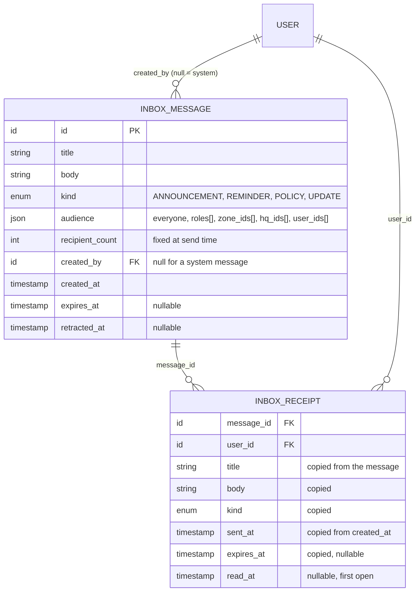

# ERD 10: Inbox

Added 2026-10-12 for PRD §6.2 D (Utility → Inbox). Rules: [`../LLD/inbox.md`](../LLD/inbox.md).

## Design decisions

- **Fan-out on write.** One receipt per recipient, with the text copied, so a person's inbox is one query on `(user_id, sent_at desc)` and who a message reached never changes later. A few hundred employees make the extra rows cheap.
- **`audience` is stored on the message** (for the Admin's sent list), not re-evaluated; the receipts are the truth of who got it.
- **Unique `(message_id, user_id)`**: a person matching several audience parts still gets one copy.
- **Retract deletes the receipts** and keeps the message row (`retracted_at`).
- Indexes: `InboxMessage(created_at desc)`; `InboxReceipt(message_id, user_id)` unique, `InboxReceipt(user_id, sent_at desc)`. No migration: new collections.
