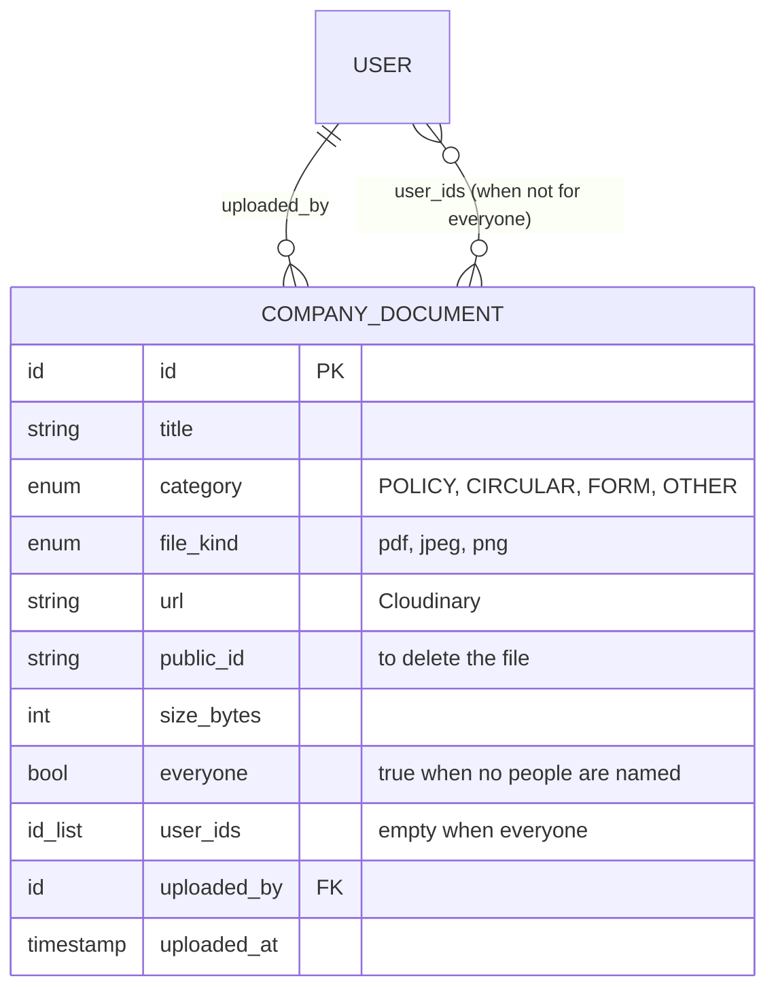

# ERD 11: Documents

Added 2026-10-12 for the phone's Docs tab. Rules: [`../LLD/documents.md`](../LLD/documents.md).

Indexes: `uploaded_at` descending; `user_ids` + `uploaded_at` for an employee's list.
