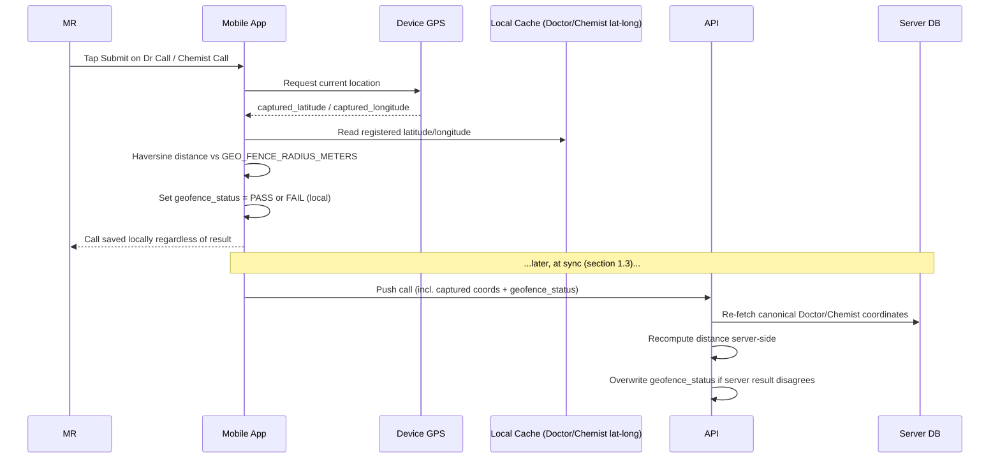

# HLD 1: Offline Sync & Geofencing

Two cross-cutting mechanisms that touch nearly every mobile-side module: how offline-created data reaches the server (PRD §2), and how a Doctor/Chemist Call's location gets verified (PRD §5.1, ERD Modules 3 & 4).

## 1. Offline Sync

### 1.1 Local data model

The mobile app's local DB mirrors two different kinds of data, handled differently:

- **Reference/master data** — `Doctor`, `Chemist`, `Route`, `Product`, `Visual`, `SystemConfig` rules, and running balances like `DoctorSampleAllocation.quantity_remaining`. Pulled as a **versioned snapshot per source** (sign-off G2 — a row-level delta can't see a Doctor appearing or vanishing when an MR's Routes change) on app foreground and periodically in the background; the app sends the version it holds and gets "unchanged" or the new snapshot. Read-mostly; the device treats it as a cache, never a source of truth.
- **Transactional records** the MR creates — `DailyPlan`, `MonthlyPlan`, `DCR` and its children (`DoctorCall`, `ChemistCall`, `DoctorFollowup`, `ChemistFollowup`, `Expense`), `Order`, `Leave`. Each gets a **client-generated UUID** as its primary key at the moment of local creation — the ID never changes when the record later reaches the server, which is what makes retries safe (see 1.3). Each carries a local `sync_status`: `DRAFT` → `QUEUED` → `SYNCED` / `FAILED`.

### 1.2 The submit boundary is explicit — one submit, at the end of the day

> **Revised 2026-09-29 (sign-off G1).** The daily report's Submit is the only moment offline data
> leaves the device: the whole day's records go in one push, and there is no background queue or
> auto-retry. Read §1.1–1.3 with that in mind: `QUEUED` means "in the day's report, waiting for
> Submit"; a failed Submit is retried by tapping it again. The design is in
> [`../LLD/sync.md`](../LLD/sync.md).

Per PRD §2, nothing transactional leaves the device automatically. A record only moves from `DRAFT` to `QUEUED` when the user taps "Submit" (per-call, or the DCR's "Final Submission"). Network availability is checked at that point and continuously afterward for anything still `QUEUED`.

**Exception: `DailyPlan`/`MonthlyPlan`/`DCR` Submit requires a live connection at tap time.** Unlike an individual `DoctorCall`/`ChemistCall`/`Expense`, which queue normally and sync whenever connectivity returns, the Submit button on these three envelopes is disabled offline — there's no `QUEUED` fallback for the submit action itself (saving as `DRAFT` is still fully offline-capable). See HLD 10 for why: Submit is what triggers the DailyPlan-approval gate and the missed-DCR compliance check, both of which need a synchronous server answer rather than an eventually-consistent one.

### 1.3 Push flow

```mermaid
sequenceDiagram
    participant MR as MR (Mobile App)
    participant Local as Local DB
    participant API as Backend API
    participant DB as Server DB

    MR->>Local: Create DCR + DoctorCall + Expense (DRAFT)
    MR->>Local: Tap "Submit" -> status = QUEUED
    Local->>API: POST /sync (batch, client UUIDs, dependency order)
    API->>API: Validate cutoffs (SystemConfig), allocations, geofence re-check
    API->>DB: Upsert by client UUID (idempotent)
    DB-->>API: Per-record result
    API-->>Local: SYNCED / FAILED (+ reason per record)
    Local-->>MR: Reflect status; failed records stay editable
```

Records push in **dependency order** — a `DCR` envelope before the `DoctorCall`/`Expense` rows that FK to it — and each request is **idempotent on the client UUID**, so a retried request after a dropped connection upserts rather than duplicates. The server returns a result **per record**, not per batch: one rejected record (e.g. "sample allocation already exhausted," "past the daily plan cutoff") surfaces its specific reason and stays `FAILED`, without swallowing the rest of that day's submission.

### 1.4 Conflict handling

Transactional data has essentially one writer per record — reinforced by the 2-device login limit (Module 1), there's no scenario of two devices editing the same offline record concurrently. The real conflict surface is **master data drift**: e.g. Admin reassigns a Doctor to a different MR while the original MR still has an offline call queued for that doctor. The server catches this at sync time (the `DoctorAssignment` check fails) and rejects/flags the record rather than silently accepting a stale assumption the device was working from.

### 1.5 Out of scope here

The Financial Year Toggle (PRD §6.2 D) is unrelated to sync — it's a read-only query against already-synced historical data, no offline queue involved.

---

## 2. Geofencing

### 2.1 Setup

A Doctor/Chemist gets a registered `latitude`/`longitude` captured once, when added (ERD Module 3) — geocoded from the address or pinned directly by whoever adds the record.

### 2.2 Capture & on-device check



The check **must** run on-device first — the MR may be submitting with no network at all, and the app already has the doctor/chemist's location cached locally as reference data (1.1). The server's recomputation at sync time is a tamper-resistance measure against a spoofed or stale local cache; if it disagrees, the server's result is authoritative and overwrites what the device computed.

### 2.2a Two more outcomes, and where the radius lives (revised 2026-09-29)

`geofence_status` is `PASS`, `FAIL`, `UNVERIFIED` or `OVERRIDE`. **`UNVERIFIED`** means the check
can't be trusted either way: the Doctor or Chemist has no registered location, or the phone's GPS
accuracy is worse than `GEO_MAX_ACCURACY_METERS`. The manager sees it like a `FAIL`. The radius,
`GEO_FENCE_RADIUS_METERS`, is SystemConfig. Detail: [`../LLD/sync.md`](../LLD/sync.md).

### 2.3 Design decision: FAIL flags, doesn't block

A geofence `FAIL` does **not** prevent the MR from submitting the call. The call saves normally with `geofence_status = FAIL` attached, and that flag is visible to the **Nearest Manager** during the same DCR approval review described in PRD §7.3 — the manager sees it alongside the call's remarks and decides whether to approve or reject, exactly like any other judgment call in that review. This was a deliberate choice over a hard block: GPS drift, weak rural signal, or a doctor's clinic having moved slightly are all real-world cases where blocking submission would stop legitimate field work, whereas flagging preserves the audit trail without punishing the MR for something outside their control.

## Next

This was the first HLD topic, addressing the two mechanisms flagged as needing explanation before moving further into HLD. See `README.md` for the index as more topics are added.
