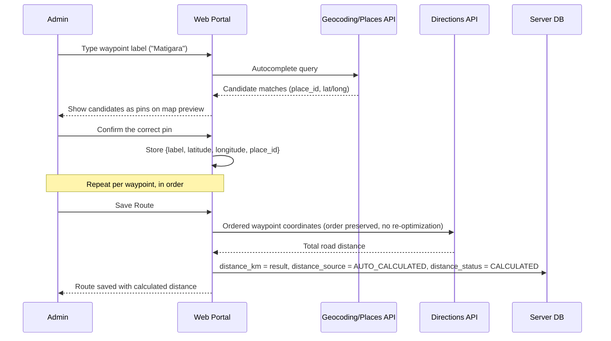
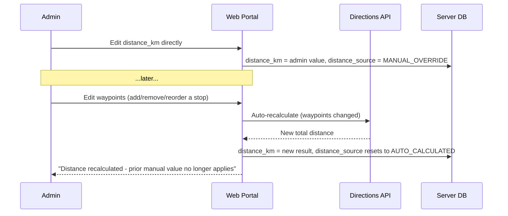

# HLD 2: Route Distance Calculation

How `Route.distance_km` actually gets populated (PRD §5.1: "an external API calculates the total distance"), and what drives the TA portion of `Expense` (ERD Modules 2 & 4).

## 1. Waypoint entry: search + map confirmation

Admin types each waypoint as a place name/address, in order (matching the PRD's "From Matigara via Medical More via Darj to Fulbari" example). A typed label alone has no coordinates and is inherently ambiguous — a place name can exist in more than one district — so text input alone isn't enough to resolve a waypoint.

The Admin UI pairs a **search box with a map preview**: typing queries a Geocoding/Places API for candidate matches, and each candidate drops a pin on an embedded map so Admin can _see_ exactly where it is before picking it — not just read a text suggestion and guess. Selecting a candidate is what actually gets stored — `{label, latitude, longitude, place_id}` — not the raw typed string. This removes the ambiguity at the source: by the time a waypoint is added to the route, Admin has visually confirmed the exact point, so the coordinates feeding the distance calculation (below) are never a guess.

## 2. Distance calculation flow

The Directions call preserves the **given order** of waypoints — it must not let the routing provider reorder stops for optimization, since "via Medical More via Darj" is a real, meaningful sequence for TA purposes, not just a set of points to visit efficiently. The result is a real road-distance route, not a straight-line (Haversine) distance between endpoints — consistent with TA being a travel reimbursement figure.

## 3. Recalculation and manual override

- **Any waypoint edit auto-recalculates immediately** — the web portal isn't offline-first, so a blocking API call at save time is acceptable, and it keeps `distance_km` from silently drifting out of date.
- **Admin can override the calculated value** directly (real money moves on this number — an inaccurate auto-calculated distance shouldn't be locked in).
- **An override doesn't survive the next waypoint edit.** Changing the route's waypoints resets `distance_source` back to `AUTO_CALCULATED` and overwrites whatever was manually set — a changed geography makes the old override stale by definition, so it isn't preserved across the edit.

## 4. Failure handling

If a waypoint can't be geocoded, or the Directions API call fails/errors, the `Route` still saves — Admin isn't blocked from entering master data — but `distance_status` stays `FAILED`/`PENDING` and `distance_km` stays null. This status is what anything downstream must check: **Expense/TA generation for a route with `distance_status != CALCULATED` must flag it rather than silently compute a TA of zero.** Blocking master-data entry on an external API being up would be too strict; blocking the financial calculation that depends on it is the right place for that constraint.

## Next

This is HLD topic 2. See `README.md` for the index.
