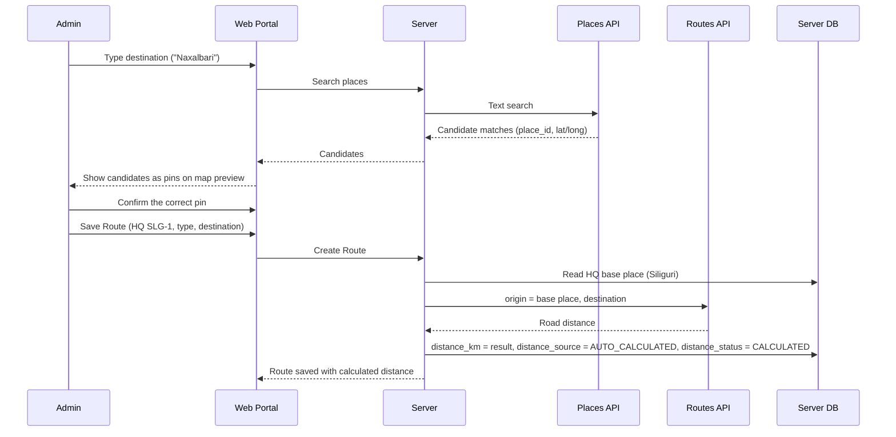

# HLD 2: Route Distance Calculation

How `Route.distance_km` actually gets populated (PRD §5.1: "an external API calculates the total distance"), and what drives the TA portion of `Expense` (ERD Modules 2 & 4).

A Route runs from its HQ's **base place** to one **destination place** (e.g. SLG-1's base place Siliguri → Naxalbari). The distance is the road distance between those two places. Before 2026-10-03 a Route was an ordered list of 2–25 waypoints; see `decision-log.md`.

## 1. Place entry: search + map confirmation

Admin enters two kinds of place the same way: an HQ's **base place**, and a Route's **destination**. Each is typed as a place name/address. A typed label alone has no coordinates and is inherently ambiguous — a place name can exist in more than one district — so text input alone isn't enough to resolve a place.

The Admin UI pairs a **search box with a map preview**: typing queries a Geocoding/Places API for candidate matches, and each candidate drops a pin on an embedded map so Admin can _see_ exactly where it is before picking it — not just read a text suggestion and guess. Selecting a candidate is what actually gets stored — `{label, latitude, longitude, place_id}` — not the raw typed string. This removes the ambiguity at the source: by the time a place is saved, Admin has visually confirmed the exact point, so the coordinates feeding the distance calculation (below) are never a guess.

## 2. Distance calculation flow



The call goes from the server, so the API key never reaches the browser. The result is a real road-distance route (drive mode), not a straight-line (Haversine) distance — consistent with TA being a travel reimbursement figure. The distance is one-way and is used as-is, never doubled (sign-off D7).

**An HQ without a base place can't get a Route.** Creating one is refused until an Admin sets the HQ's base place.

## 3. Recalculation and manual override

```mermaid
sequenceDiagram
    participant Admin
    participant Portal as Web Portal
    participant API as Server
    participant Dir as Routes API
    participant DB as Server DB

    Admin->>Portal: Edit distance_km directly
    Portal->>DB: distance_km = admin value, distance_source = MANUAL_OVERRIDE
    Note over Admin,Portal: ...later...
    Admin->>Portal: Change the destination
    API->>Dir: Auto-recalculate (destination changed)
    Dir-->>API: New distance
    API->>DB: distance_km = new result, distance_source resets to AUTO_CALCULATED
    API-->>Portal: "Distance recalculated - prior manual value no longer applies"
    Note over Admin,Portal: ...or...
    Admin->>Portal: Change the HQ's base place
    API->>Dir: Recalculate each active Route that is not MANUAL_OVERRIDE
    API->>DB: Update those Routes; leave overridden Routes alone
    API-->>Portal: Counts: recalculated, failed, overridden Routes left as they were
```

- **Any destination edit auto-recalculates immediately** — the web portal isn't offline-first, so a blocking API call at save time is acceptable, and it keeps `distance_km` from silently drifting out of date.
- **A base-place change recalculates the HQ's active Routes**, one call per Route. This is a batch, so each Route is handled on its own: one `FAILED` does not stop the rest, and the response says how many succeeded and failed.
- **Admin can override the calculated value** directly (real money moves on this number — an inaccurate auto-calculated distance shouldn't be locked in).
- **An override doesn't survive the next destination edit.** Changing the destination resets `distance_source` back to `AUTO_CALCULATED` and overwrites whatever was manually set — a changed geography makes the old override stale by definition.
- **An override does survive a base-place change.** An HQ edit is not an edit to that Route, and discarding hand-entered distances in bulk would be a silent loss. The response names the overridden Routes so Admin can re-check them, or retry with `POST /routes/:id/recalculate`, which does reset the override.

## 4. Failure handling

If the Routes API call fails/errors, the `Route` still saves — Admin isn't blocked from entering master data — but `distance_status` is `FAILED` and `distance_km` stays null. The call has a ~5 s timeout; Admin retries with `POST /routes/:id/recalculate`. This status is what anything downstream must check: **Expense/TA generation for a route with `distance_status != CALCULATED` must flag it rather than silently compute a TA of zero.** Blocking master-data entry on an external API being up would be too strict; blocking the financial calculation that depends on it is the right place for that constraint.

## Next

This is HLD topic 2. See `README.md` for the index.
