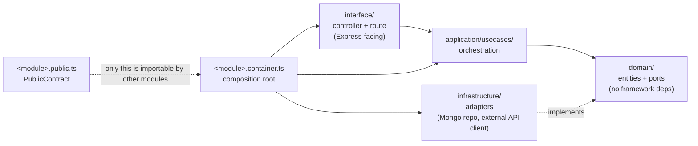
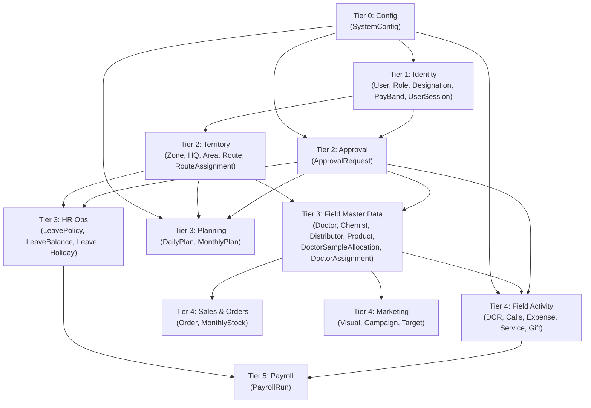

# HLD 3: System Architecture Overview

How the Modular Monolith (PRD §2) is actually structured in code, and how the 9 ERD modules map onto it. Written after inspecting the repo's existing scaffolding (`apps/api`), not invented from scratch — the `health` module already establishes the pattern every business module below follows.

## 1. Stack

- **Backend:** Node.js + TypeScript + Express, in a pnpm/Turborepo monorepo (`apps/api`, `packages/config`).
- **Database:** MongoDB via **Mongoose**. Mongoose schemas/models are defined and used only inside each module's `infrastructure/` adapter, implementing the same repository **ports** used today (`HealthProbePort`-shaped) — `domain/` and `application/` never import Mongoose, so domain entities stay plain TS types and framework-agnostic. Mongoose's own schema validation is the primary validation layer at the persistence boundary.
- **Mobile:** React Native + SQLite for the local offline store (op-sqlite or a similar sync-friendly layer, with Drizzle for local query building). A `packages/shared` workspace package holds types/validation shared between `apps/api` and the future `apps/mobile`.
- **External APIs:** Geocoding/Places + Directions (HLD 2).

## 2. Module structure (established by the `health` module)

Every business module (Identity, Territory, Field Master Data, ...) follows the same four-layer shape already in `apps/api/src/modules/health/`:

- **`domain/`** — entities and **ports** (interfaces for anything external: a Mongo repository, the Geocoding API, etc.). No Express, no MongoDB driver import here.
- **`application/usecases/`** — one class per use case, depending only on ports (constructor-injected), same shape as `GetHealthUseCase`.
- **`infrastructure/`** — concrete adapters implementing those ports (a Mongo-backed repository is exactly the same kind of adapter as `MemoryHealthProbe`, just against a real collection instead of memory).
- **`interface/`** — Express controller + route, translating HTTP ↔ use case calls.
- **`<module>.container.ts`** — builds the adapters, injects them into use cases, and exposes `{ contract, buildRouter }`.
- **`<module>.public.ts`** — the `PublicContract` type. **This is the only thing another module is allowed to import.** No module reaches into another's `domain/`/`infrastructure/` directly — cross-module calls go through the contract, exactly like `health.public.ts` today.

## 3. Module dependency tiers

The top-level `container.ts` already builds modules in explicit tiers (the `health` module is commented "Tier 0"). Mapping the 9 ERD modules onto this, by which module's data each one's foreign keys actually reach into:

**Why `Config` had to split out of the ERD's "Planning" grouping:** in the ERD discussion, `SystemConfig` was introduced alongside Module 5 (Planning) because the daily/monthly cutoffs were the first two examples. But `Identity` needs it too (`MAX_REGISTERED_DEVICES_FIELD` at login) and `Field Activity` needs it too (`GEO_FENCE_RADIUS_METERS`) — and neither of those can depend on a "Planning" module without breaking the tier order (Identity is Tier 1, Planning would be Tier 3). So in the actual code, `Config` is its own Tier 0 module with zero dependencies, exposing a `contract.get(key)` that every other module calls through its `PublicContract` — the ERD module numbering reflects _discussion order_, not the code's dependency graph.

## 4. Relational ERD → MongoDB mapping

The ERD docs use FK/join-table language (`RouteAssignment`, `DoctorAssignment`, `HolidayZone`/`HolidayHQ`, `OrderItem`) because that's the clearest way to express the logical model. Physically, on MongoDB:

- Every entity in the ERD is its own **collection** — including the join tables. `RouteAssignment` and `DoctorAssignment` are not embedded arrays on `Route`/`Doctor`; they stay separate collections referencing `_id`s, the same many-to-many shape as the ERD shows, just without a DB-enforced foreign key.
- **Referential integrity is enforced in the application layer**, inside the repository adapters — e.g. creating a `RouteAssignment` checks both referenced `_id`s resolve via the `Territory`/`Identity` module's contracts before insert, rather than relying on a DB constraint.
- Whether any particular relationship gets **embedded** instead (e.g. `MonthlyPlanEntry` inside its parent `MonthlyPlan` document, since it's always read/written together with its parent and never queried independently) is a per-collection call made at the LLD stage based on real access patterns — not decided here.

## Next

This is HLD topic 3. See `README.md` for the index.
