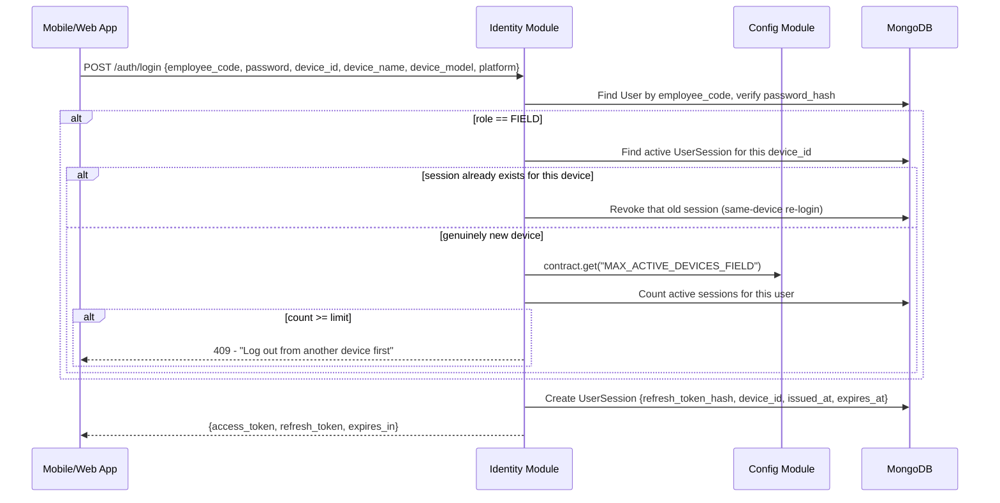
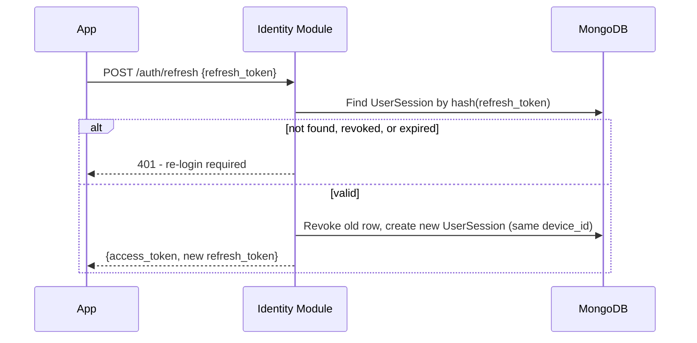

# HLD 4: Authentication & Session Management

How login, token refresh, and the FIELD-role 2-device limit (ERD Module 1) actually work end to end.

## 1. Token model

- **Access token** — short-lived JWT (e.g. 15 min), stateless. Every normal API request is authorized by verifying its signature and expiry — no DB lookup needed per request.
- **Refresh token** — a long-lived opaque random string, stored **hashed** (`refresh_token_hash`) in `UserSession`, one row per logged-in device. This is what makes per-device revocation and the device-count limit possible (a stateless JWT alone couldn't be individually revoked).
- **Refresh token rotation:** every time a refresh token is used to get a new access token, the old `UserSession` row is revoked and a new one is issued for the same device. If an already-revoked (i.e. already-rotated) refresh token is ever presented again, that's a signal of theft — the server treats it as reuse and revokes **all** of that user's sessions as a precaution, not just the one being used.

## 2. Login flow (including the device limit)

The device-limit check only fires for a **genuinely new** `device_id` — re-logging in on a device that already has an active session just replaces that device's own session, and doesn't count against the limit. Web-portal roles (`ADMIN`/`HR`/`ACCOUNTANT`) skip this branch entirely, per Module 1's FIELD-only scoping. The limit value itself is read from `Config` at request time, not hardcoded — consistent with HLD 3's dependency tiers (Identity, Tier 1, depends on Config, Tier 0).

## 3. Token refresh flow

## 4. Logout

A single call, `POST /auth/logout {refresh_token}`, sets `revoked_at = now()` on the matching `UserSession` row. Because sessions are per-device rows rather than a single token blob, **Admin can also force-revoke every session for a user** (e.g. during offboarding) by revoking all their `UserSession` rows at once — a natural extension of the same mechanism, not a separate feature.

## Next

This is HLD topic 4. See `README.md` for the index.
