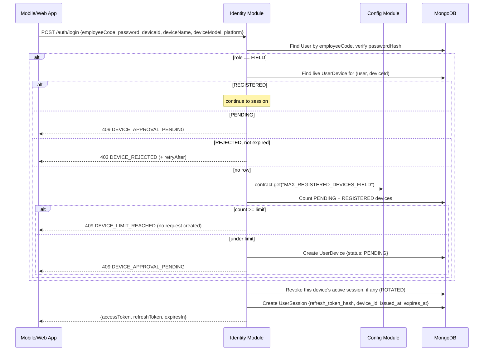
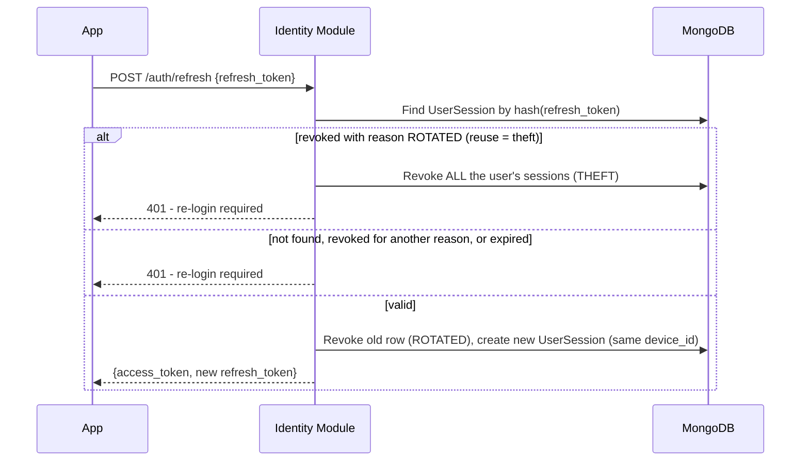

# HLD 4: Authentication & Session Management

How login, token refresh, and FIELD-role device approval (ERD Module 1) actually work end to end.

## 1. Token model

- **Access token** — short-lived JWT (e.g. 15 min), stateless. Every normal API request is authorized by verifying its signature and expiry — no DB lookup needed per request.
- **Refresh token** — a long-lived opaque random string, stored **hashed** (`refresh_token_hash`) in `UserSession`, one row per logged-in device. This is what makes per-device revocation and the device-count limit possible (a stateless JWT alone couldn't be individually revoked).
- **Refresh token rotation:** every time a refresh token is used to get a new access token, the old `UserSession` row is revoked (`revoked_reason: ROTATED`) and a new one is issued for the same device. If a **rotated** refresh token is ever presented again, that's a signal of theft — the server revokes **all** of that user's sessions as a precaution. A token revoked for any other reason (logout, Admin device logout/removal, password reset) just gets a `401`: its phone retrying it is expected, and must not log the employee out of their other phone.

## 2. Login flow (including device approval)

**Every new phone needs Admin approval, including the first one** (client sign-off A2–A3). The
first login from a phone creates a `PENDING` request and is refused; once Admin approves it
(`POST /users/:id/devices/:deviceRowId/approve`), the employee simply logs in again. The limit
counts pending + registered phones, and at the limit a new phone is refused with "You already
have 2 devices. Ask Admin to remove an old device first" **without** creating a request.
**Logging out never frees a slot**; only Admin removing a registered phone (or rejecting a pending
one) does. A rejected phone is blocked for `REJECTED_DEVICE_TTL_DAYS` (default 7), after which a
MongoDB TTL index deletes the rejection and the phone counts as new.

Web-portal roles (`ADMIN`/`HR`/`ACCOUNTANT`) skip the device branch entirely: no registry, no
limit. Both settings are read from `Config` at request time, not hardcoded — consistent with
HLD 3's dependency tiers (Identity, Tier 1, depends on Config, Tier 0).

The app, not the backend, supplies `deviceId`/`deviceName`/`deviceModel` — an HTTP request alone
can't identify a phone. How the Android app reads them is in
[`../LLD/identity.md`](../LLD/identity.md#where-device_id-and-device_name-come-from).

## 3. Token refresh flow

## 4. Logout, device actions and password reset

Every way a session ends records why, in `revoked_reason`:

| Action | Who | Ends | Reason |
|---|---|---|---|
| `POST /auth/logout {refresh_token}` | the user | that one session | `LOGOUT` |
| `POST /auth/logout-all {userId}` | Admin | every session of the user (offboarding) | `ADMIN` |
| `POST /users/:id/devices/:deviceRowId/logout` | Admin | that phone's sessions; phone stays registered | `ADMIN` |
| `DELETE /users/:id/devices/:deviceRowId` | Admin | that phone's sessions, and the phone is unregistered (frees a slot) — one transaction | `ADMIN` |
| `POST /users/:id/reset-password {newPassword}` | Admin only | every session; registered phones stay registered | `PASSWORD_RESET` |
| `POST /auth/delete-account {password}` / `POST /users/:id/anonymise` | the user / Admin, HR | every session, and the phones are unregistered (account deleted) | `ADMIN` |

**Deactivation** (`POST /users/:id/deactivate`, Admin, 2026-10-22) ends every session too (`ADMIN`) and also refuses, from that
moment, every access token the account was issued before it (an in-memory list in `shared/http/accessRevocations.ts`, checked
by `authenticate` against the token's `iat`; no database read per request, re-filled on restart from recent deactivations).
Without it a deactivated employee's open screens kept working until their access token expired (up to 15 minutes).

None of these trigger theft detection (§3), so ending one phone's session never logs the
employee out of another.

## Next

This is HLD topic 4. See `README.md` for the index.
