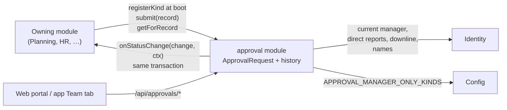
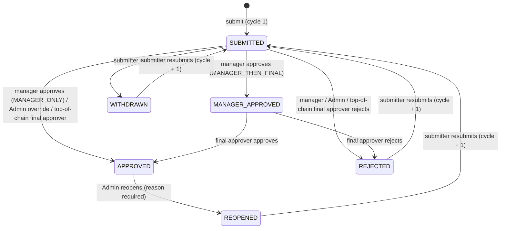
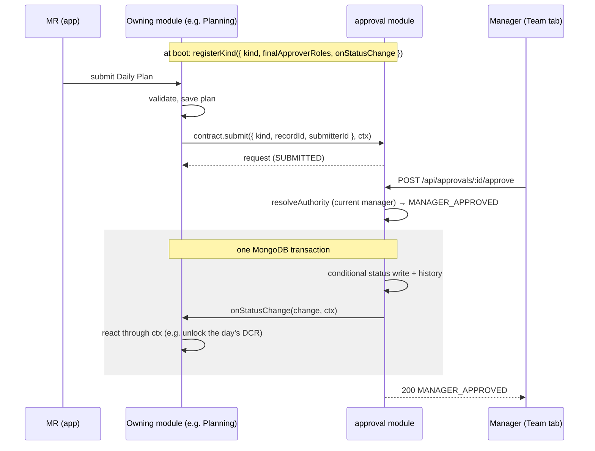

# HLD 5: Approval Workflow Engine

The one mechanism every "submit → get approved" flow in the system goes through — Daily and
Monthly Plans, DCR & Expenses, Leave, Doctor creation, Doctor Service and whatever else the
client's final list adds (PRD §7.1; client `RULES BY GREYNOTE.docx` §19). Built in Phase 3 as the
`approval` module (`apps/api/src/modules/approval/`). Module-level detail — contract, HTTP
surface, edge cases — is in [`../LLD/approval.md`](../LLD/approval.md).

## 1. A module, not a shared library

The first design (kept in `../decision-log.md`) was a helper each module called, with each
module storing `status` / `reviewed_by` on its own records. It was dropped because the client
asks for **one common approval screen** across every kind (§19.6), and Admin needs one org-wide
queue of everything pending: with state spread over five modules' collections, both would query
and merge them all.

So approval state lives in one place — an `ApprovalRequest` per approvable record, owned by the
`approval` module (tier 2, beside Territory; depends only on Identity and Config). The owning
module keeps its record (the Plan, the Leave); the request is the workflow around it.

## 2. The request

One `ApprovalRequest` per `(kind, recordId)`, ever — a resubmission reuses it.

| Field | Meaning |
|---|---|
| `kind` | e.g. `DAILY_PLAN`, `LEAVE` — registered by the owning module |
| `recordId` | the owning module's record |
| `submitterId` | who submitted |
| `status` | see §3 |
| `workflow` | `MANAGER_THEN_FINAL` or `MANAGER_ONLY`, snapshotted at each (re)submission (§6) |
| `cycle` | 1, then +1 per resubmission |
| `submittedAt` / `decidedAt` | the current cycle's submission; when it was decided |
| `history[]` | every action: `action`, `authority`, `actorId`, `actorRole`, `comment`, `at`, `resultingStatus`, `cycle` |

The history is the audit trail: nothing is overwritten, and each entry records *why* the actor
was allowed to act (§4), so "Admin approved over the manager's head" is visible, not inferred.

## 3. States

- **Open** = `SUBMITTED` or `MANAGER_APPROVED` (someone must decide).
- **Editable by the submitter** = `REJECTED`, `WITHDRAWN`, `REOPENED` only. Pending means
  withdraw first; **approved means locked** — only Admin can reopen it (product owner,
  2026-09-24). Owning modules enforce this on their own edit endpoints via
  `isEditableBySubmitter(status)`.
- A rejection and a reopen need a reason; approval comments are optional.
- Each owning module decides which status unlocks what *for it* — HLD 10's DCR gate needs only
  a `MANAGER_APPROVED` (or `APPROVED`) Daily Plan; Payroll will count only `APPROVED` expenses.

## 4. Who may act

Resolved on every action by one pure function (`domain/approvalRules.ts#resolveAuthority`):

| Status | Actor | Authority | Approve leads to |
|---|---|---|---|
| `SUBMITTED` | the submitter's **current** manager | `MANAGER` | `MANAGER_APPROVED`, or `APPROVED` if `MANAGER_ONLY` |
| `SUBMITTED` | a final approver, when the submitter has **no manager** | `TOP_OF_CHAIN` | `APPROVED` |
| `SUBMITTED` | any Admin, at any time | `ADMIN_OVERRIDE` | `APPROVED` |
| `MANAGER_APPROVED` | a final approver | `FINAL` | `APPROVED` |

- **Final approvers** are fixed per kind by the owning module: always `ADMIN`; Leave adds `HR`.
  HR has no Stage-1 override — HR acts at the final stage, or directly only on a top-of-chain
  submission.
- **Nobody acts on their own request** — including an HR user's own leave, which Admin decides.
- **Admin's override is final in one step.** When the manager can't act (resigned, inactive, on
  leave, simply hasn't) Admin approves directly — no per-reason detection, one standing rule.
  It goes straight to `APPROVED` rather than `MANAGER_APPROVED`, since Admin would otherwise
  approve the same request twice (decision-log 2026-09-24).
- **Top of chain** (an NSM, or any submitter without a manager) has no Stage 1: the final
  approver decides alone (PRD §7.1.4).

## 5. The approver is resolved live

The Stage-1 approver is `submitter.managerId` **at the moment someone acts**, not a value
stored at submission. If an employee is moved to a new manager, their pending requests move
with them — no reconciliation job. Admin's override covers the gap when the current manager is
inactive.

**Read-only visibility** is the same idea one level out: a manager sees the requests of their
whole downline (`Identity.getDownline`, one `$graphLookup`, computed live — never stored on the
request). Direct reports' Stage-1 requests are actionable; everyone deeper is read-only
(PRD §7.1.3). Admin sees everything by role; HR sees the kinds where HR is a final approver.

## 6. Turning the final stage off per kind

`SystemConfig.APPROVAL_MANAGER_ONLY_KINDS` (seeded `NONE`) lists kinds that end at the manager —
e.g. `DAILY_PLAN` if Admin approving every daily plan for every MR is too much. Every other kind
goes manager → final approver (client §19.3). It is read at each submission and resubmission
and snapshotted on the request, so a change applies from the next cycle and never re-routes a
request already in flight. One list key rather than a key per kind, because kinds register at
runtime and `SystemConfig` only lets Admin edit keys that were seeded.

## 7. How an owning module plugs in

- **`registerKind`** once at boot: the kind name, its final approver roles (must include
  `ADMIN`), and optionally `onStatusChange`.
- **`submit(input, ctx?)`** for the first submission and every resubmission; `ctx` lets the
  owning module save its record and submit in one transaction. No callback fires for a submit —
  the owning module started it.
- **`onStatusChange(change, ctx)`** fires on every decision, withdrawal and reopen, **inside the
  same transaction** as the status change. The owning module writes through `ctx`; if it throws,
  the status change rolls back too, so the approval can never say "approved" while, say, the
  leave balance was never deducted. It may run twice on a transient-error retry, so it keeps to
  database writes on `ctx` — notifications go elsewhere (client sign-off F8, still open).
- **`getForRecord(kind, recordId)`** is the source of truth for a record's approval state.
  Owning modules should read it rather than keep their own copy of the status.

The transaction plumbing (`TransactionRunnerPort`, the Mongoose runner) lives in
`apps/api/src/shared/db/` because a transaction here spans two modules.

## 8. Concurrency

Every status change is a conditional write — "move to X *if still* in Y, on cycle N". Two
approvers acting at once: one wins, the other gets `409` and nothing of theirs is committed. The
same guard covers a resubmit racing a reopen, and a decision racing a withdrawal.

Status alone isn't enough: withdraw + resubmit brings a request back to `SUBMITTED` on a new
cycle, possibly with an edited record behind it. So the write also matches the cycle it was
decided on, and over HTTP an approver sends the `cycle` they were shown — a decision on a
resubmission they haven't seen is a `409` ("reload it"), never an approval of content they
didn't look at.

## Next

This is HLD topic 5. See `README.md` for the index; the module's contract, HTTP surface and edge
cases are in [`../LLD/approval.md`](../LLD/approval.md).
