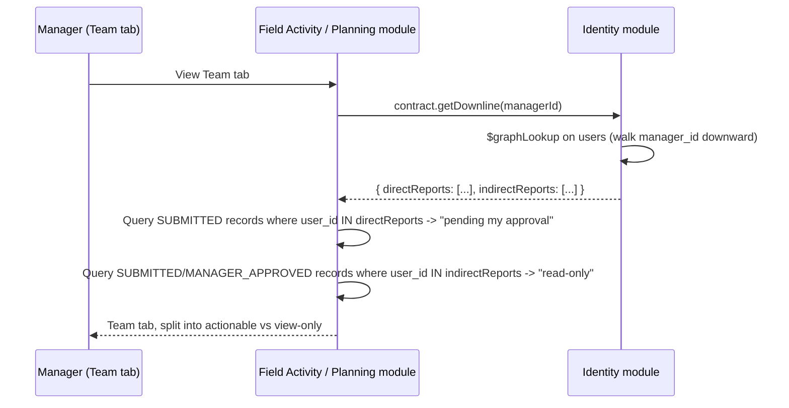

# HLD 5: Approval Workflow Engine

The generalized two-stage (Nearest-Manager → Admin) + read-only-escalation mechanism (PRD §7.1) that `DCR`, `DailyPlan`/`MonthlyPlan`, and MR-submitted `DoctorService` all share — instead of four copies of the same logic.

## 1. Shared shape

Every "approvable" entity carries the same fields: `user_id` (submitter), `status` (`SUBMITTED`/`MANAGER_APPROVED`/`REJECTED`), `reviewed_by` (nullable until acted on), `reviewed_at`. Rather than duplicating the approve/reject logic once per module, each module's use case delegates to a small shared **Approval** helper (a plain function/service in `packages/shared`, not a network call — it's logic, not a module with its own data) that both resolves the approver and validates the transition. Each module still owns its own collection and status field; only the _logic_ is shared.

## 2. Resolving the approver — and the edge case it exposes

The nearest-higher-manager approver is just `submitter.manager_id` — a single-hop lookup, not a walk, since only the direct manager approves (PRD §7.1).

**Edge case this surfaces:** the top of the FIELD hierarchy (an NSM, or whoever has `manager_id = NULL`) still submits their own DCR/Plan per PRD §7.1 ("every employee — including managers themselves"). But `NULL.manager_id` means there's no nearest higher manager to approve it. **Resolution:** when `submitter.manager_id IS NULL`, the submission routes directly to Admin, who acts as the sole approver for that one record — there's no separate Stage 2 in that case, since Admin already handled it in Stage 1.

## 3. Read-only visibility — computed via downline lookup, not stored

Anyone strictly above the approver in the chain gets read-only visibility (PRD §7.1, §7.2, §7.3). Rather than storing that visibility set on every record, it's computed live by asking the Identity module for a manager's downline:

`getDownline` uses MongoDB's `$graphLookup` (a native recursive-traversal aggregation stage — the closest equivalent to a SQL recursive CTE) starting from the manager and walking `manager_id` downward, then partitions the result into **direct reports** (can approve) vs **everyone else in the downline** (read-only). This runs live, at Team-tab view time — not snapshotted onto each record — since the hierarchy is shallow (at most MR→ASM→RSM→ZSM→NSM, 5 levels) and this isn't a hot path; it only runs when a manager opens the tab, not on every read of every record.

**Trade-off, noted but not chosen:** a materialized `visible_to_manager_ids` array snapshotted onto each record at submission time would be cheaper to query but risks going stale if someone's manager changes between submission and review. Given the shallow hierarchy and low view frequency, the live query is simpler and doesn't need a reconciliation job — revisit only if this ever shows up as a real performance problem.

## 4. Admin visibility is role-based, not hierarchy-based

Once `status = MANAGER_APPROVED`, **any** user with `Role = ADMIN` can see the record — this is a plain role check, not a hierarchy walk to "whoever sits above the top manager." This matches Module 1: `manager_id = NULL` means top-of-chain, not "reports to Admin" — there's no requirement that an NSM's chain literally terminates at a specific Admin user, and multiple Admins can all see the same approved record.

## Next

This is HLD topic 5. See `README.md` for the index.
