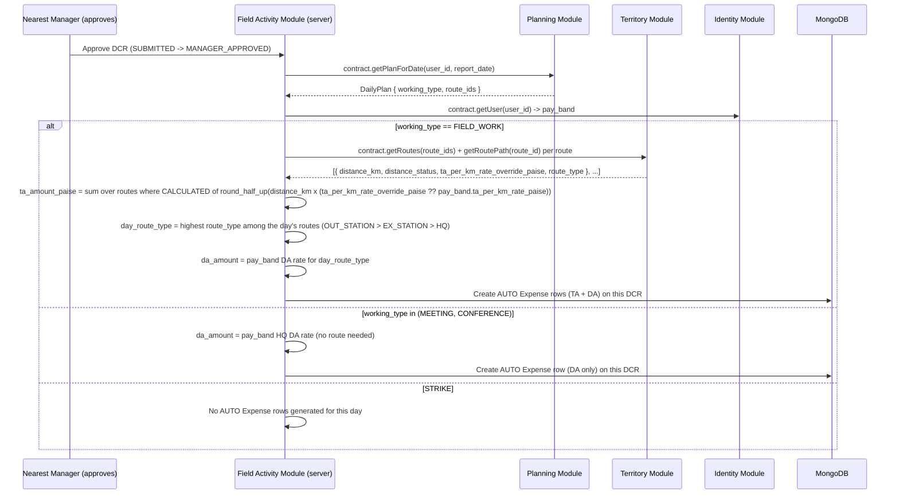

# HLD 6: TA/DA Auto-Calculation

How the `AUTO`-sourced `Expense` rows (TA, DA) actually get computed (PRD glossary: TA = Route Distance × Per-Km Rate; client Master spec: DA = Route Type + Grade rate, i.e. each grade has separate HQ / Ex Station / Out Station DA rates) — ties Module 2's distance calc, Module 1's `PayBand` rates, Module 5's `DailyPlan`, Module 4's `Expense`, and HLD 5's approval engine together.

## Money and rounding (decided 2026-09-29)

Every amount here is whole paise. The only fractional step is TA: `distance_km` (a 2-decimal figure) times a
rate in paise per km. It is **rounded half up to a whole paise once per route, when the amount is
created** (`multiplyPaise` in `shared/money/paise.ts`, exact integer arithmetic, no floats), and the
integer is what is stored and summed — a day's TA is the sum of its routes' rounded amounts, never a
rounded total. DA is a rate, already whole paise. See `../engineering/coding-standards.md`, *Money*.

## 1. Computed server-side, never trusted from the client

**TA/DA amounts are always computed on the server**, ignoring whatever the client payload might carry for those fields. The mobile app _may_ show the MR a local estimate for UX, but that number is non-authoritative — a compromised or buggy client must never be able to inflate a travel-allowance claim by sending a pre-computed amount the server just accepts. Consistent with HLD 1's "never trust the offline payload outright" stance.

## 2. Trigger: DCR approval, not submission

Generation fires when the Nearest Manager **approves** a `DCR` (`SUBMITTED → MANAGER_APPROVED`, HLD 5) — not when the MR first submits it. Generating an expense claim off unverified data would be backwards, and if the DCR is instead `REJECTED`, nothing should ever be created for it.

- **TA only applies to `FIELD_WORK`.** It's the one working type where a route is actually required in that day's `DailyPlan` — no route, nothing to compute a distance from, so `MEETING`/`CONFERENCE` never get a TA row at all, regardless of pay band.
- **DA applies to `FIELD_WORK`, `MEETING`, and `CONFERENCE`.** Only `STRIKE` (not working) excludes it. DA is **one amount per day**, not per route. The rate is the user's grade rate for that day's **Route type**. Each grade carries three DA rates — `hq_da`, `ex_station_da`, `out_station_da` (client Master spec M2, e.g. G1: HQ ₹0 / Ex Station ₹200 / Out Station ₹500). The day's type comes from its Plan routes (`Route.type`, ERD 02; moved from `Area` 2026-10-03).
- **A day touching routes in different Route types uses the highest one** (`OUT_STATION` > `EX_STATION` > `HQ`). An MR who went out-station at all that day incurred out-station costs. This tie-break is this doc's call; the client spec doesn't state one — confirm with the client before Phase 6.
- **`MEETING`/`CONFERENCE` days have no route**, so they have no Route type. They default to the `HQ` rate. Also a provisional call, same confirm-before-Phase-6 note.
- **Out-station trips (2026-10-12).** A Monthly Plan entry may carry a `returnDate`; the days after the first up to the return are `STAY` days, the return day is a `TRANSIT` day (`PlanDay.dayKind`, default `NORMAL`). A `STAY` day pays DA at the out-station rate and **no TA**. A `TRANSIT` day pays TA as field work does and DA at the **ex-station** rate. The trip's first day is ordinary (TA + out-station DA); a same-day return has no `returnDate` and stays ordinary. The client confirmed no separate Night Stay allowance is needed (sign-off D2, 2026-10-12), so none is computed.
- **Holiday/weekly-off impact on DA** is an open client question (client rules §8.5, §25.3). Not handled until answered.
- **Route source (when TA applies):** the day's `DailyPlan.route_ids` for that `user_id` + date — not routes pulled from individual `DoctorCall` rows. `DailyPlan` is what explicitly captures "Select Routes" for the day (PRD §6.2 A).
- **Rates:** the DA rate always comes from the user's current `PayBand` (Module 1) at approval
  time, from its `hqDa` / `exStationDa` / `outStationDa` fields. The TA rate resolves **per route**, not once for the whole day — added 2026-09-23,
  `docs/decision-log.md`: each route in the sum can carry its own `ta_per_km_rate_override`
  (ERD-02), and only falls back to `pay_band.ta_per_km_rate` when that route has none set. A
  `DailyPlan` with multiple routes for `FIELD_WORK` can therefore mix a negotiated rate on one
  route with the pay-band default on another in the same day's TA total — this is why the rate
  resolution happens **inside** the sum, applied per route, rather than once after summing every
  route's distance.

## 3. No manual override for the generated amount

Unlike `Route.distance_km` or `Route.ta_per_km_rate_override` (both Admin-editable, ERD 02), the `AUTO` `Expense` amount itself is not manually editable once generated. Since generation now happens exactly once, after Manager approval, from already-verified inputs — a correction belongs at the source: if the underlying route distance or rate override was wrong, Admin fixes it on the `Route` itself, which then applies to _future_ approvals. It doesn't retroactively touch `Expense` rows already generated for past approvals — same "locked snapshot" principle as `PayrollRun` (HLD 7) and the Financial Year Toggle (HLD 9).

## 4. Edge cases

- **No matching `DailyPlan` for that date** at approval time — no `AUTO` TA row is generated (DA still generates if the working type qualifies and a plan/working-type is known some other way — in practice this means Manager approval should require a resolved working type, which normally comes from that day's `DailyPlan`). A day with no plan at all is a gap for the Accountant's audit step (PRD §5.3) to catch, not something the system fabricates a number for.
- **A route with `distance_status != CALCULATED`** (HLD 2: since 2026-10-14 this only means a Route with no km typed yet) contributes **zero** to the TA sum rather than blocking approval entirely, and the resulting `Expense` should be flagged so the Accountant's audit doesn't mistake an artificially-low TA for a legitimately short route.
- **Generation happens exactly once per DCR.** Since it's tied to the one-way `SUBMITTED → MANAGER_APPROVED` transition (a `DCR` doesn't get re-approved), there's no "regenerate on resubmission" case to handle — a `REJECTED` DCR that gets fixed and resubmitted goes through the same one-time trigger on its next approval.

## Next

This is HLD topic 6. See `README.md` for the index.
