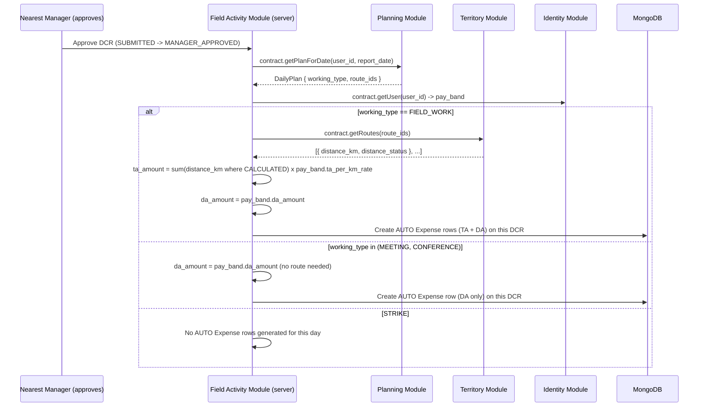

# HLD 6: TA/DA Auto-Calculation

How the `AUTO`-sourced `Expense` rows (TA, DA) actually get computed (PRD glossary: TA = Route Distance × Per-Km Rate; DA = fixed daily amount, both by Pay Band) — ties Module 2's distance calc, Module 1's `PayBand` rates, Module 5's `DailyPlan`, Module 4's `Expense`, and HLD 5's approval engine together.

## 1. Computed server-side, never trusted from the client

**TA/DA amounts are always computed on the server**, ignoring whatever the client payload might carry for those fields. The mobile app _may_ show the MR a local estimate for UX, but that number is non-authoritative — a compromised or buggy client must never be able to inflate a travel-allowance claim by sending a pre-computed amount the server just accepts. Consistent with HLD 1's "never trust the offline payload outright" stance.

## 2. Trigger: DCR approval, not submission

Generation fires when the Nearest Manager **approves** a `DCR` (`SUBMITTED → MANAGER_APPROVED`, HLD 5) — not when the MR first submits it. Generating an expense claim off unverified data would be backwards, and if the DCR is instead `REJECTED`, nothing should ever be created for it.

- **TA only applies to `FIELD_WORK`.** It's the one working type where a route is actually required in that day's `DailyPlan` — no route, nothing to compute a distance from, so `MEETING`/`CONFERENCE` never get a TA row at all, regardless of pay band.
- **DA applies to `FIELD_WORK`, `MEETING`, and `CONFERENCE`.** It's grade-based (`pay_band.da_amount`), not route-dependent — any day actually spent working earns it. Only `STRIKE` (not working) excludes it.
- **Route source (when TA applies):** the day's `DailyPlan.route_ids` for that `user_id` + date — not routes pulled from individual `DoctorCall` rows. `DailyPlan` is what explicitly captures "Select Routes" for the day (PRD §6.2 A).
- **Rates** (`ta_per_km_rate`, `da_amount`) come from the user's current `PayBand` (Module 1) at approval time.

## 3. No manual override for the generated amount

Unlike `Route.distance_km` (HLD 2, which Admin _can_ override), the `AUTO` `Expense` amount itself is not manually editable once generated. Since generation now happens exactly once, after Manager approval, from already-verified inputs — a correction belongs at the source: if the underlying route distance was wrong, Admin fixes it via `Route`'s own override (HLD 2), which then applies to _future_ approvals. It doesn't retroactively touch `Expense` rows already generated for past approvals — same "locked snapshot" principle as `PayrollRun` (HLD 7) and the Financial Year Toggle (HLD 9).

## 4. Edge cases

- **No matching `DailyPlan` for that date** at approval time — no `AUTO` TA row is generated (DA still generates if the working type qualifies and a plan/working-type is known some other way — in practice this means Manager approval should require a resolved working type, which normally comes from that day's `DailyPlan`). A day with no plan at all is a gap for the Accountant's audit step (PRD §5.3) to catch, not something the system fabricates a number for.
- **A route with `distance_status != CALCULATED`** (HLD 2) contributes **zero** to the TA sum rather than blocking approval entirely, and the resulting `Expense` should be flagged so the Accountant's audit doesn't mistake an artificially-low TA for a legitimately short route.
- **Generation happens exactly once per DCR.** Since it's tied to the one-way `SUBMITTED → MANAGER_APPROVED` transition (a `DCR` doesn't get re-approved), there's no "regenerate on resubmission" case to handle — a `REJECTED` DCR that gets fixed and resubmitted goes through the same one-time trigger on its next approval.

## Next

This is HLD topic 6. See `README.md` for the index.
