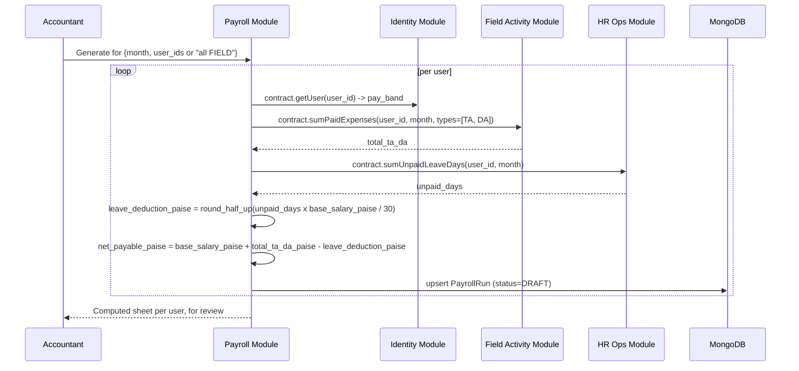

# HLD 7: Payroll Generation Flow

How the Accountant's `PayrollRun` (ERD Module 9) actually gets generated and finalized.

## 1. Generation flow

- **Bulk-capable:** Accountant can generate for one user or the whole FIELD workforce for a month in one action — each user gets their own `PayrollRun` row, computed independently.
- **Leave deduction rate: `base_salary / 30`, flat**, regardless of the actual calendar month length or working-day count. This is deliberately the simplest of three options considered (vs. actual calendar days, vs. actual working days excluding Sundays/Holidays) — matches common payroll practice and avoids pulling Module 7's Holiday/weekly-off data into every payroll calculation.
- **`total_ta_da` only counts `PAID` expenses** (HLD 6 / Module 4's `payment_status`) — an approved-but-unpaid TA/DA claim doesn't count toward this month's payroll yet, same rule already locked in Module 9's ERD.

## 2. Idempotency and the Draft -> Finalized lock

- Generating again for a user+month that already has a `DRAFT` `PayrollRun` **recomputes and overwrites it** — nothing is locked in yet, so Accountant can regenerate freely while reviewing (e.g. after catching and fixing a missed unpaid-expense mark).
- Generating for a user+month that's already `FINALIZED` is **rejected** — per Module 9's design decision, a finalized run is a locked historical record. If a real correction is needed after finalization, that's a manual adjustment process (out of scope for this HLD — not something the generation flow itself handles).
- **Finalizing** (`POST /payroll/{id}/finalize`) sets `status = FINALIZED` and stamps `finalized_at`. From that point, the row's `base_salary`, `total_ta_da`, `leave_deduction`, and `net_payable` are frozen, even if the underlying `Expense`/`Leave` data for that month changes afterward.

## Next

This is HLD topic 7. See `README.md` for the index.
