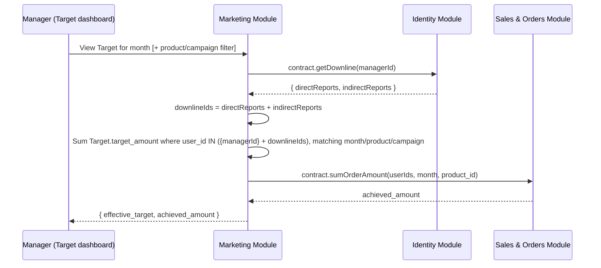

# HLD 8: Target Rollup Query

How a manager's effective target — their own `Target` row plus their downline's, per the ERD Module 8 decision — actually gets computed.

## 1. Reuses HLD 5's downline mechanism

This doesn't need new machinery. The Identity module's `contract.getDownline(managerId)` — built for HLD 5's approval read-only-visibility — already returns everything a rollup needs: the full set of a manager's direct and indirect reports via the same `$graphLookup` walk. Target rollup just flattens both into one set (it doesn't need the direct/indirect distinction the approval engine cares about) and sums against it.

## 2. Live, not cached — same reasoning as HLD 5

Computed fresh on each view rather than materialized, for the same reasons as the approval-visibility query: the hierarchy is shallow (≤5 levels) and a target sum over a handful of downline rows is cheap. **One difference worth flagging:** a Target dashboard is plausibly checked more often than a Team-tab approval list (e.g. a manager glancing at their %-achieved daily), so if this ever becomes a real load concern, a nightly-materialized rollup cache is the natural escape hatch — noted here as the option, not built now, same "don't optimize before it's a real problem" stance as HLD 5.

## 3. "Achieved" stays derived, per Module 8

The `achieved_amount` side of the equation was already decided in the ERD (Module 8): summed from `OrderItem` rows, not stored anywhere. This HLD topic just extends that same derivation to cover a manager's full downline, not only their own `OrderItem` rows.

## Next

This is HLD topic 8. See `README.md` for the index.
