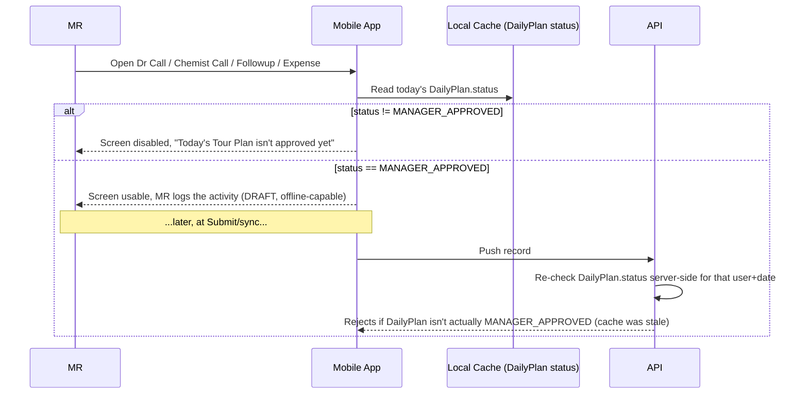
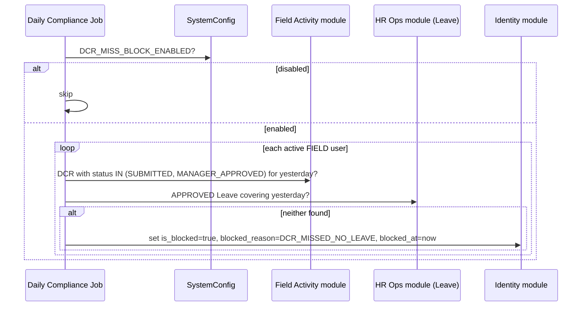

# HLD 10: Submission Gating & Compliance Block

Two related rules that keep a field employee's daily workflow honest: you can't log field activity for a day whose Tour Plan isn't approved, and you can't keep skipping DCR submission without consequence.

## 1. DailyPlan-approval gate

An MR cannot create `DoctorCall`, `ChemistCall`, `DoctorFollowup`, `ChemistFollowup`, or `Expense` (ERD Module 4) for a given date until that date's `DailyPlan` (ERD Module 5) is `MANAGER_APPROVED`.

The client-side check is a UX gate against the locally-synced `DailyPlan` status (reference data, HLD 1 §1.1). The server re-checks at sync time — same reasoning as the `DoctorAssignment` re-validation in HLD 1 §1.4: the device's cached status can be stale (e.g. the manager rejected it after the last sync), so the server's answer is authoritative and the record is rejected/flagged if it disagrees.

This is why `DailyPlan` Submit itself requires a live connection (HLD 1 §1.2, ERD Module 5) — the MR needs a synchronous "approved / not yet" answer before the rest of the day's logging unlocks, not an eventually-consistent one from a queued submission.

## 2. Missed-DCR compliance block

A daily job (server-side, runs after the day rolls over — exact trigger time is an LLD/ops concern, not a schema one) scans active `FIELD`-role users:

`DCR_MISS_GRACE_DAYS` (ERD Module 5, default `1`) is the number of consecutive missed days tolerated before the block fires — the job only blocks once a user has exceeded that count with no covering Leave.

**While `is_blocked = true`:**

- `DailyPlan`/`MonthlyPlan` Submit — rejected.
- `DCR` Final Submission — rejected.
- Creating any DCR child — rejected (same use-case-level check as the DailyPlan-approval gate above, just keyed off `is_blocked` instead of `DailyPlan.status`).

**Still available while blocked:** requesting `Leave` and viewing historical reports — the block only stops _new_, forward-looking submissions, so the MR can still retroactively explain the gap (e.g. file the missing Leave request) rather than being locked out of every screen.

**Clearing the block is Admin-only** (ERD Module 1: `unblocked_by` must resolve to an `ADMIN`-role user), from the Web Portal — the Nearest Manager cannot clear it, even though the Nearest Manager is the Stage 1 approver for everything else this user submits (PRD §7.1). This mirrors Admin's existing role as the top-of-chain authority (HLD 5 §4) but is a deliberate exception: this is a compliance/punitive action, not a routine approval, so it's scoped to Admin alone.

## Next

This is HLD topic 10. See `README.md` for the index.
